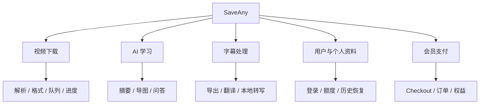
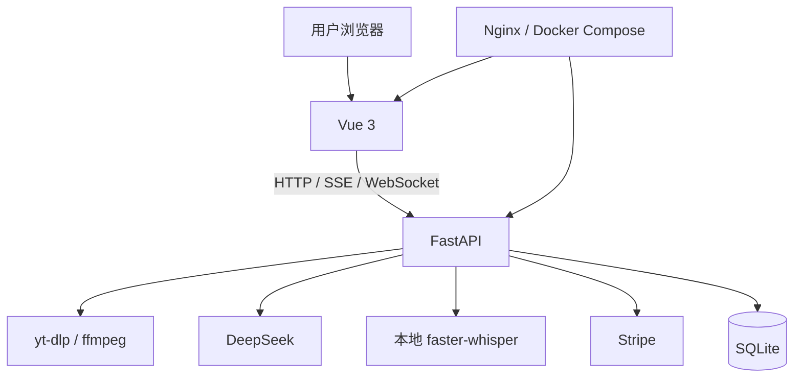

# AI 万能视频下载总结器（SaveAny）

> 参考项目：[程序员鱼皮 free-video-downloader](https://github.com/liyupi/free-video-downloader)
>
> 本项目为学习实践版本，提供视频下载、AI 总结、字幕处理、个人历史、后台队列和测试会员支付。
>
> ⭐️ 本地运行教程：[保姆级本地运行指南](./docs/保姆级本地运行指南.md)

## 一、项目介绍

SaveAny 是一个基于 **Vue 3 + FastAPI + yt-dlp + DeepSeek + Stripe** 的视频下载与 AI 学习工具。输入链接后选择格式保存视频，再通过摘要、字幕、思维导图和问答整理内容。


### 为什么做这个项目？

保存不同平台的视频，常常需要寻找不同下载方式。遇到长教程或技术分享，还要先花时间判断内容是否值得完整观看。

这个项目将 **视频下载 + AI 内容整理** 放在同一入口中：先解析和下载，再阅读摘要、导出字幕、查看导图和连续追问。处理过的总结可以从个人历史免费恢复，多条下载可以交给后台队列继续执行。

**从一个视频链接开始，保存内容，整理知识。**

下方功能示意图来自参考项目，实际应用采用 A 舒展版布局，功能和额度以本文为准。独立演示页面见[交互原型](./prototypes/README.md)。


⚠️ 合规使用声明：本项目用于技术学习和研究，请仅处理自己拥有版权或已获授权的内容，遵守平台规则。

### 7 大核心能力

1）多平台视频解析和下载：基于 yt-dlp 处理 B 站、YouTube、抖音等平台，展示真实标题、封面和可用格式，支持直链与服务端代理下载，游客无需登录即可使用。实际可用性受视频权限、网络和平台限制影响。

登录后可每批提交最多 10 条链接，查看后台任务的真实进度，取消或重试下载。关闭页面后继续执行，准备好的文件保留 24 小时。


2）AI 视频总结摘要：提取真实字幕后调用 DeepSeek，流式生成概述、大纲、要点和一句话总结。登录后先恢复保存结果，无结果且额度可用时自动生成，重新总结失败保留旧内容。


3）AI 生成思维导图：将视频内容整理为可折叠、缩放、拖拽的交互导图，支持全屏和完整 SVG / 高清 PNG（4K+）导出，当前画布缩放不影响导出范围。


4）AI 视频问答：根据字幕和最近对话连续追问，回答流式展示，未提供的信息明确说明。问答与总结独立计量，摘要、导图和问答分析字幕前 15000 字符，完整字幕仍可导出。


5）字幕导出、翻译与本地转写：字幕可导出 SRT / VTT / TXT，本人保存内容可翻译为简体中文、英语和日语。翻译最多 20000 原文字、1000 段，保留时间戳，不截断处理。

没有平台字幕时，用户可主动启用本地 small / CPU / int8 转写，先获得字幕，再决定是否生成总结。依赖与模型需单独准备，单条视频最多 30 分钟。


6）用户注册登录 + 额度管理 + 个人历史

邮箱账号使用密码哈希、JWT 和服务端会话，登录有效期 72 小时，退出撤销当前会话。个人历史、任务、成功结果和订单按账号隔离。

免费账号每日 **总结 3 次、问答 10 次、翻译 3 次、转写 60 分钟**，北京时间零点恢复，完整成功才计量。保存结果可免费恢复，失败或完成前取消释放预占。

7）Stripe 会员支付：当前测试商品为 **¥9.9 / 30 天，不自动续费**，VIP 每日 **总结 30 次、问答 100 次、翻译 20 次、转写 240 分钟**。免费账号同样可以批量下载和导出字幕，免费/VIP 单条转写均最多 30 分钟。

权益由服务端确认付款后授予，重复回调不重复延长，页面回跳不能直接开通。缺配置时不开放购买，正式收款尚未验证，配置见[扩展运行指南](./docs/【剩余扩展】本地运行与验收.md)。

## 二、项目优势

项目将视频处理、AI 内容展示和个人资料恢复串成完整使用流程，可以从实际操作理解前端交互、后端任务、数据保存与外部服务如何配合。

主要技术如下：

| 层次 | 技术 |
|------|------|
| 前端页面 | Vue 3 + Vite + Tailwind CSS |
| 内容展示 | marked + DOMPurify + typography + markmap |
| 视频与接口 | FastAPI + yt-dlp + ffmpeg / ffprobe |
| AI 与字幕 | DeepSeek + SSE + faster-whisper |
| 用户与数据 | bcrypt + PyJWT + SQLite |
| 后台任务 | SQLite 队列 + WebSocket |
| 会员支付 | Stripe Checkout + Webhook |
| 部署与公开页 | Docker Compose + Nginx + 构建时预渲染 |

从这个项目中可以学习：

- 如何根据需求和原型组织前后端模块与页面？
- 如何处理视频格式、下载回退、音视频合并和失败提示？
- 如何展示 AI 流式摘要、交互导图和连续问答？
- 如何实现会话撤销、账号隔离、并发额度和免费结果恢复？
- 如何管理持久任务、真实进度、字幕翻译与本地语音转写？
- 如何接入测试支付、保存业务数据，并准备容器部署和公开页面？

### 本项目学习实践优势

项目提供需求、方案、原型和运行指南，并配有核心业务测试。可以先跑通游客下载，再按需配置 AI、字幕和支付，逐项阅读对应模块。

SQLite 无需独立服务，转写与支付不影响基础启动。平台可用性、识别准确率和长视频速度受实际环境影响，具体条件见运行指南。

## 三、更多介绍

功能围绕下载、内容整理和个人资料展开，模块关系如下：



前后端通过 HTTP、SSE 和 WebSocket 通信，文本与任务保存在 SQLite，视频和模型处理各自独立。



完整功能见[需求分析](./docs/需求分析.md)，架构和核心接口见[方案设计](./docs/方案设计.md)。首页和 `/guide/` 预渲染公开正文，个人页面始终不索引；没有正式域名时默认不生成公开规范地址，配置方法见[SEO 与 GEO 运行指南](./docs/SEO与GEO运行指南.md)。

## 四、快速运行

> 完整步骤和常见问题见[保姆级本地运行指南](./docs/保姆级本地运行指南.md)。以下命令适用于 Windows PowerShell。

### 1. 前置条件

先安装运行工具，AI 和支付按需配置。

- Python 3.11 或更新的兼容版本
- Node.js 22.12+，附带 npm
- ffmpeg / ffprobe，加入 PATH
- DeepSeek API Key：摘要、导图、问答和翻译需要，解析与下载可暂不配置

### 2. 克隆项目

已有代码时直接进入当前目录；否则将地址替换为当前 SaveAny 版本的仓库地址。

```powershell
git clone "替换为当前 SaveAny 项目的仓库地址" video-downloader
cd video-downloader
```

参考仓库用于学习来源对照，不包含本项目后续增加的全部功能。

### 3. 启动后端

从项目根目录安装依赖并编辑配置，已有 `.venv` 和 `.env` 继续使用。

```powershell
python -m venv .venv
.venv/Scripts/python.exe -m pip install -r backend/requirements.txt
if (!(Test-Path backend/.env)) { Copy-Item backend/.env.example backend/.env }
notepad backend/.env
```

首次使用时生成至少 32 字节的随机 JWT 密钥，将输出填入 `JWT_SECRET`；已有密钥保持不变，DeepSeek 默认模型为 `deepseek-flash`。

```powershell
.venv/Scripts/python.exe -c "import secrets; print(secrets.token_urlsafe(48))"
```

配置完成后启动后端，SQLite 自动建表，升级先备份并保留账号和结果。

```powershell
.venv/Scripts/python.exe -m uvicorn backend.main:app --host 127.0.0.1 --port 8000 --reload --reload-dir backend
```

### 4. 启动前端

另开位于项目根目录的终端，安装并启动前端。

```powershell
cd frontend
npm.cmd ci
npm.cmd run dev
```

### 5. 访问使用

浏览器打开 http://127.0.0.1:5173 ，粘贴授权视频链接体验解析和下载；登录后使用 AI、历史、队列和字幕。公开指南位于 `/guide/`，后端 API 文档为 http://127.0.0.1:8000/docs 。

可选 Docker 入口为 http://127.0.0.1:8080 ，配置好 `backend/.env` 后从根目录执行 `docker compose build`、`docker compose up -d`。停止服务按 `Ctrl+C` 或 `docker compose down`，不加 `-v`，保留数据卷。

后台采用单实例、单后端进程，不同时启动两份服务指向同一库和下载目录。Fake-IP 代理、转写、支付、备份和容器数据导入见[本地运行指南](./docs/保姆级本地运行指南.md)与[扩展运行指南](./docs/【剩余扩展】本地运行与验收.md)。

## 加入项目学习

可以从[需求分析](./docs/需求分析.md)和[方案设计](./docs/方案设计.md)开始，通过[交互原型](./prototypes/README.md)了解页面，再按运行指南启动项目。

账号、额度与恢复见[用户子系统方案](./docs/【用户与AI额度子系统】方案设计文档.md)，任务、字幕与支付见[扩展接口与数据方案](./docs/【剩余扩展】接口与数据方案.md)。原作者学习资料见[参考项目](https://github.com/liyupi/free-video-downloader)，课程和服务以其官方介绍为准。
