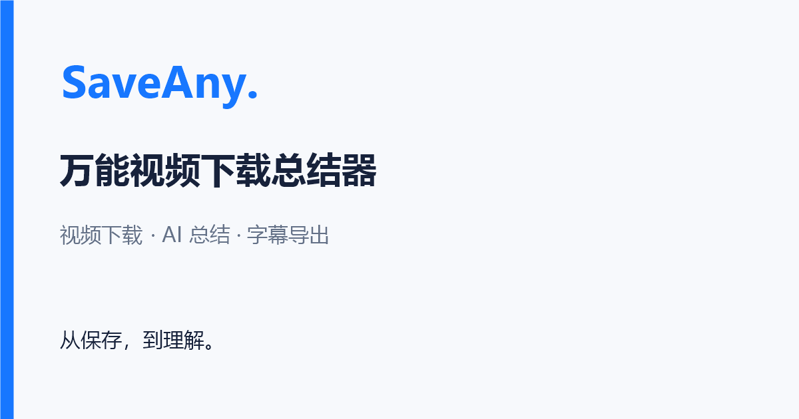
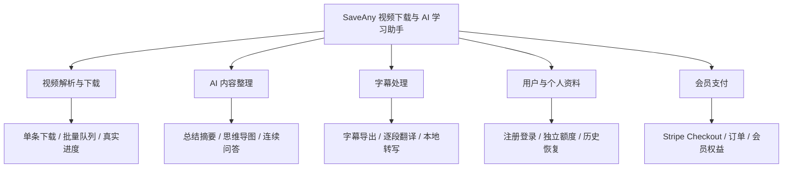
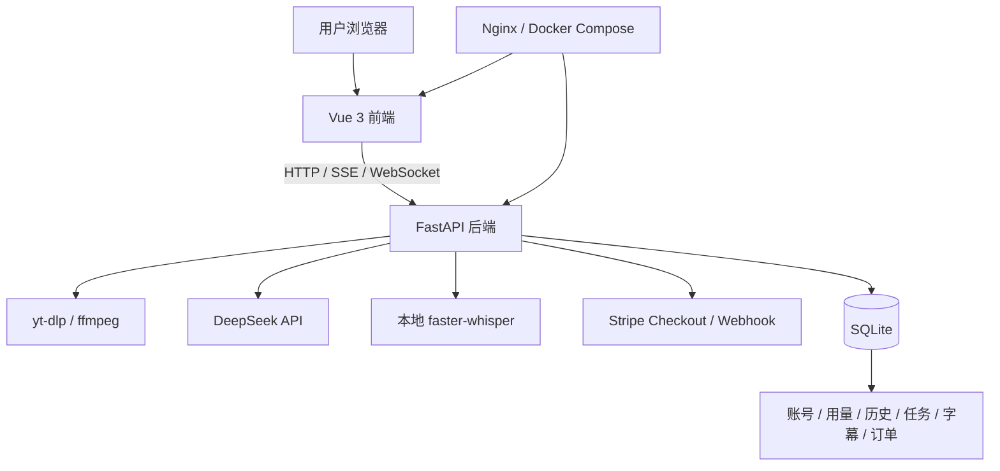

# AI 万能视频下载总结器（SaveAny）

> 参考项目：[程序员鱼皮 free-video-downloader](https://github.com/liyupi/free-video-downloader)
>
> 本项目为学习实践版本，基于原项目思路完成视频下载与 AI 总结，并扩展账号额度、个人历史、后台队列、字幕翻译、本地转写、会员支付及 SEO/GEO 功能。
>
> ⭐️ 本地运行教程：[保姆级本地运行指南](./docs/保姆级本地运行指南.md)


## 一、项目介绍

这是一个基于 **Vue 3 + FastAPI + yt-dlp + DeepSeek + Stripe** 开发的 AI 视频下载与学习工具。输入视频链接，就能解析视频信息、选择格式下载，并通过 AI 生成总结摘要、思维导图和视频问答，把视频里的内容整理成方便阅读和保存的学习资料。




### 为什么做这个项目？

平时看到一个值得保存的视频，比如技术教程、公开课程，或者自己上传的作品，想下载到本地反复观看，常常要在不同平台之间寻找下载方法。遇到清晰度限制、音视频分离、链接失效等情况，操作起来也不够方便。

如果视频比较长，还需要先花时间判断它讲了什么、哪些内容值得重点看。能在下载前读到一份摘要和内容大纲，再结合思维导图和问答梳理知识点，就能更快找到自己需要的部分。

这就是 AI 万能视频下载总结器想解决的问题：通过一个入口完成 **视频下载 + AI 内容整理**。下载能力基于 yt-dlp 的多平台支持，覆盖 B 站、YouTube、抖音等平台；在此基础上增加 **个人历史、批量任务、字幕翻译和语音转写**，让处理过的视频和学习资料能够继续找回使用。

**一个视频链接，从保存视频到整理知识！**

下面的功能示意图来自原始参考项目，当前版本采用 A 舒展版布局，功能和额度以本文说明为准。当前界面及原型对比见[原型说明](./prototypes/README.md)。


⚠️ 合规使用声明：本项目用于技术学习和研究，请仅下载自己拥有版权或已获得授权的内容，遵守相关平台的使用规则。


### 7 大核心能力

1）多平台视频解析和下载：基于 yt-dlp 解析视频标题、封面、时长和可用格式，支持直链下载与服务端代理下载，针对抖音提供专用解析模块。游客无需登录即可解析和单条下载；实际可用性受视频权限、平台限制和网络环境影响，清晰度以源视频返回的格式为准。

登录后还可以每批提交最多 10 条链接，放入后台队列，查看 WebSocket 推送的真实下载进度，支持取消和下载任务手动重试。关闭页面后任务继续执行，准备好的文件保留 24 小时，方便稍后领取。


2）AI 视频总结摘要：自动提取平台字幕，调用 DeepSeek 大模型生成视频概述、内容大纲、核心知识要点和一句话总结，通过 SSE 流式输出，使用 Markdown 排版展示，帮助用户快速了解视频内容。

登录后先恢复已有成功结果，没有保存结果且额度可用时自动生成。刷新、退出重登和重启后端都可以免费恢复；主动重新总结成功才再次使用额度，失败保留上次成功内容。摘要、导图与问答使用字幕前 15000 字符，长视频会提示分析范围。


3）AI 生成思维导图：基于字幕内容生成可交互的思维导图，支持节点折叠、缩放拖拽、适应画布和全屏展示，也可以导出完整的高清 PNG（4K+）和 SVG 矢量图，方便整理笔记。


4）AI 视频问答：围绕视频内容提问，AI 根据字幕和最近的对话给出回答，支持连续追问和流式展示。字幕中没有的信息会明确说明，问答额度与总结额度独立计算，问答正文不持久保存。


5）字幕导出、翻译与本地转写：支持阅读带时间戳的字幕，并导出 SRT、VTT、TXT 文件。本人保存的总结字幕或转写字幕可以翻译为简体中文、英语、日语，保留原时间戳，切换原文和译文后继续导出。

没有平台字幕时，可以主动启用本地 faster-whisper 语音转写，先获得字幕，再决定是否生成总结。转写依赖与 small / CPU / int8 模型需单独准备，单条视频最多 30 分钟；翻译单次最多 20000 原文字、1000 段，成功结果都可免费恢复。


6）用户注册登录 + 额度管理 + 个人历史

支持邮箱和密码注册登录，密码使用 bcrypt 哈希保存，JWT 配合服务端会话验证身份。登录有效期 72 小时，退出会撤销当前会话；账号之间的历史、任务和成功结果相互隔离。

免费账号每天可使用 **3 次总结、10 次问答、3 次翻译、60 分钟转写**，四项额度相互独立，按服务端北京时间零点恢复。完整成功才计量，失败、完成前取消或任务过期释放预占；个人历史可以直接打开保存的字幕、摘要和导图，不依赖重新解析视频，也不重复扣次。

7）Stripe 会员支付：集成 Stripe Checkout 和签名回调，当前测试商品为 **¥9.9 / 30 天，不自动续费**。会员每日额度为 **30 次总结、100 次问答、20 次翻译、240 分钟转写**，单条转写仍最多 30 分钟，批量下载和字幕导出同样向免费登录用户开放。

会员权益由服务端确认付款后授予，重复回调不重复延长有效期，页面回跳参数不能直接开通。当前已完成 Stripe 测试环境付款验证，缺少配置时不开放购买，正式收款尚未验证。支付配置见[扩展运行指南](./docs/【剩余扩展】本地运行与验收.md)。


## 二、项目优势

本项目以 **实用工具 + AI 学习** 为出发点，把视频解析下载、AI 内容整理和个人资料恢复放在同一个使用流程里。从输入链接到保存视频，再到阅读摘要、导出字幕和追问内容，每一步都有可以实际操作的结果，适合用来学习前后端项目的完整开发过程。

技术丰富，覆盖从页面交互到后台处理的多个环节：

| 层次 | 技术 |
|------|------|
| 前端页面 | Vue 3 + Vite + Tailwind CSS |
| 内容展示 | marked + DOMPurify + typography + markmap |
| 后端接口 | FastAPI + Python |
| 视频处理 | yt-dlp + ffmpeg / ffprobe + 抖音专用解析 |
| AI 能力 | DeepSeek 兼容接口 + SSE 流式输出 |
| 用户与数据 | bcrypt + PyJWT + SQLite |
| 后台任务 | SQLite 持久队列 + WebSocket 真实进度 |
| 字幕转写 | faster-whisper，本地 small / CPU / int8 |
| 会员支付 | Stripe Checkout + Webhook |
| 部署与公开页面 | Docker Compose + Nginx + 构建时预渲染 |

从这个项目中你可以学到：

- 如何用 AI 编程完成需求分析、方案设计、前后端开发和验证？
- 如何复用开源下载工具，并针对不同视频平台进行适配？
- 如何通过 DeepSeek 生成视频摘要、思维导图和连续问答？
- 如何使用 SSE 展示流式内容，并处理取消、失败和重试？
- 如何结合 JWT、服务端会话和 SQLite 实现账号与个人数据隔离？
- 如何设计独立额度、并发预占、成功计量及免费结果恢复？
- 如何实现后台下载队列、WebSocket 真实进度和文件过期清理？
- 如何完成逐段字幕翻译，并使用本地模型为无字幕视频生成字幕？
- 如何接入 Stripe 测试支付、验证回调，并避免重复授予会员？
- 如何使用 Docker 固定运行环境，并完成 SEO/GEO 上线前优化？


### 本项目学习实践优势

项目提供 **需求分析、方案设计、界面原型和运行维护** 资料，并配有核心业务测试。除了看功能怎么实现，还可以结合文档了解为什么这样设计、遇到平台限制和模型失败时怎样处理，以及升级后如何保留用户数据。

本地运行无需安装独立数据库服务，基础功能也不要求配置支付和语音模型。可以先跑通视频下载，再逐步体验 AI、历史、队列、字幕和会员功能，按自己的学习进度增加配置。

项目包含视频下载、AI 总结与字幕处理、Docker 运行和 Stripe 测试支付，可以按需逐项体验。平台限流、网络条件、语音识别准确率和长视频处理速度仍有实际限制，使用条件见[扩展运行指南](./docs/【剩余扩展】本地运行与验收.md)。


## 三、更多介绍

功能模块：



架构设计：



详细需求和实现方式见[需求分析](./docs/需求分析.md)与[方案设计](./docs/方案设计.md)。首页和公开使用指南 `/guide/` 在构建时输出完整 HTML，包含产品介绍、操作步骤和常见问题；没有正式域名时默认不索引，配置 `VITE_SITE_URL` 后重新构建才生成公开页面的规范网址和网站地图，个人工作台、历史、队列及订单始终不索引。

SEO/GEO 当前完成上线前技术准备，真实搜索收录和 AI 引用需上线后观察，配置方法见[SEO 与 GEO 运行指南](./docs/SEO与GEO运行指南.md)。


## 四、快速运行

> 详细的保姆级教程请参考 [保姆级本地运行指南](./docs/保姆级本地运行指南.md)


### 1. 前置条件

- Python 3.11 或更新的兼容版本
- Node.js >= 22.12
- ffmpeg / ffprobe（用于音视频合并、音轨处理和时长检查）
- 一个 [DeepSeek API Key](https://platform.deepseek.com/)（用于摘要、导图、问答和翻译；只解析和下载可暂不配置）

以下命令适用于 **Windows PowerShell**。除明确进入 `frontend` 的步骤外，从项目根目录执行；macOS / Linux 将 `.venv/Scripts/python.exe` 换成 `.venv/bin/python`、`npm.cmd` 换成 `npm`，配置复制命令使用对应终端的写法。

### 2. 克隆项目

已经有本地代码的同学，直接打开当前 `video-downloader` 目录即可。如果从自己的远程仓库获取代码，把下面的地址替换成当前 SaveAny 版本的仓库地址：

```powershell
git clone "替换为当前 SaveAny 项目的仓库地址" video-downloader
cd video-downloader
```

原始参考仓库用于学习来源对照，不包含本项目后续增加的全部扩展功能。

### 3. 启动后端

从项目根目录安装依赖，复制配置并填写密钥。已有 `.venv` 和 `.env` 可以继续使用，不需要删除重建：

```powershell
python -m venv .venv
.venv/Scripts/python.exe -m pip install -r backend/requirements.txt
if (!(Test-Path backend/.env)) { Copy-Item backend/.env.example backend/.env }
notepad backend/.env
```

`JWT_SECRET` 必须是至少 32 字节的随机值，首次配置时运行下面命令生成，再填入 `.env`。已有密钥保持不变，DeepSeek 默认模型为 `deepseek-flash`。

```powershell
.venv/Scripts/python.exe -c "import secrets; print(secrets.token_urlsafe(48))"
```

配置完成后启动后端：

```powershell
.venv/Scripts/python.exe -m uvicorn backend.main:app --host 127.0.0.1 --port 8000 --reload --reload-dir backend
```

SQLite 首次启动自动建表，升级先备份并保留已有账号、额度和成功结果，不要删除数据库处理登录或升级故障。后台队列采用单实例、单后端进程，不要同时启动两份后端指向同一数据库和下载目录。

### 4. 启动前端

打开另一个终端，从项目根目录执行：

```powershell
cd frontend
npm.cmd ci
npm.cmd run dev
```

### 5. 访问使用

浏览器打开 http://127.0.0.1:5173 ，输入视频链接即可体验视频解析和单条下载。登录后可以使用 AI、个人历史、后台队列和字幕功能，公开使用指南位于 http://127.0.0.1:5173/guide/ ，后端 API 文档位于 http://127.0.0.1:8000/docs 。

如果视频链接在本机代理环境中被解析为 `198.18.x.x` 而遭到拒绝，仅在确认使用 Fake-IP 代理时，在启动后端的终端设置 `$env:ALLOW_PROXY_FAKE_IP = 'true'` 后重新启动；该兼容默认关闭，不能用于访问内网地址。

也可以安装并启动 Docker 后，在配置好 `backend/.env` 的项目根目录运行 `docker compose build`、`docker compose up -d`，访问 http://127.0.0.1:8080 。Docker 默认使用独立数据卷，不自动合并本机库；停止时使用 `docker compose down` 保留数据，不加 `-v`。

更多配置细节（环境变量、Stripe 测试支付、本地转写、常见问题等）请查看[保姆级本地运行指南](./docs/保姆级本地运行指南.md)，扩展功能的配置、备份与检查见[扩展运行指南](./docs/【剩余扩展】本地运行与验收.md)。在各服务终端按 `Ctrl+C` 即可停止，已保存的账号和成功文本结果继续保留。


## 加入项目学习

如果你想跟着这个项目练习，建议从[需求分析](./docs/需求分析.md)和[方案设计](./docs/方案设计.md)开始，再结合[界面原型](./prototypes/README.md)理解使用流程，按照[保姆级本地运行指南](./docs/保姆级本地运行指南.md)把项目运行起来，逐步阅读视频下载、AI、账号额度和后台任务的实现。

账号与额度的实现细节见[用户与 AI 额度子系统方案](./docs/【用户与AI额度子系统】方案设计文档.md)，历史、队列、字幕和会员接口见[扩展接口与数据方案](./docs/【剩余扩展】接口与数据方案.md)。

参考项目与原作者学习资料见[程序员鱼皮 free-video-downloader](https://github.com/liyupi/free-video-downloader)。本仓库说明对应当前学习实践版本，原作者的课程和服务以其官方介绍为准。
