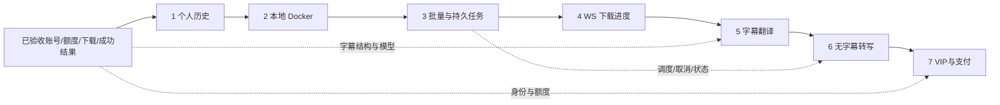

# SaveAny 剩余扩展：接口与数据方案

本方案让七项扩展沿用当前 Vue、FastAPI、sqlite3、下载器和模型模块。先把用户可观察的状态、数据归属及接口说清楚，前后端才能按同一份约定并行实现，不靠各自猜测字段。

方案已获确认并实施，对应[需求与验收](./【剩余扩展】需求与验收.md)及[总计划](./【剩余扩展】总计划与阶段记录.md)。2026-11-02 已完成本地自主验收，Docker与Stripe按用户确认通过、免本次环境实测，技术事实仍为未运行容器或支付商联调；详见[自主验收记录](./【剩余扩展】自主验收记录.md)。不改写已验收账号子系统的历史验收记录。

## 1. 方案比较与依赖

推荐在现有项目中增加少量明确职责的模块，以 SQLite 保存任务，进程内调度有限工作线程。当前是本地单实例工具，还没有跨服务器共享队列或大规模检索需求。

| 方案 | 得失 | 结论 |
| --- | --- | --- |
| SQLite 持久任务 + 单进程调度 + 现有模块 | 保留账号数据和部署方式，少量新依赖；需要明确重启恢复与协作取消 | 推荐 |
| Redis + Celery + 多服务 | 分布式任务能力更强，但新增服务、运行配置和恢复问题 | 本轮不做 |
| 浏览器内存队列/纯 JSON 历史 | 开始快，但重启丢状态，不能可靠隔离账号与并发 | 不满足需求 |



实线是用户指定的交付顺序，虚线是直接技术依赖。Docker 不可用或 Stripe 未配置时继续做独立代码与隔离验证，但不能把后续代码完成当成此前真实联调已经通过。

## 2. 数据保存及升级方式

保留现有四张业务表和原来成功结果的唯一键，只做有版本、有备份的增量升级。新翻译/转写额度另建一张表，避免为增加 `kind` 重建原 `ai_usage_requests` 或改变既有 3/10 计次规则。

| 表 | 主要字段、唯一性与职责 |
| --- | --- |
| 现有 `users`、`auth_sessions`、`ai_usage_requests` | 字段和原记录保留；不迁移参考项目账号，不改原 kind CHECK(summary/chat) |
| 扩展 `summary_results` | 原主键 `(user_id,url,language)` 不变；新增 `result_id TEXT`、`video_title TEXT NOT NULL DEFAULT ''`、`platform TEXT NOT NULL DEFAULT ''`；回填稳定随机 ID 后建唯一索引，仍由成功计次事务 UPSERT 同一条结果 |
| `schema_migrations` | `version INTEGER PRIMARY KEY, applied_at INTEGER`，记录增量升级，不承担业务数据 |
| `download_history` | `id TEXT PK, user_id FK, url, video_title, platform, format_id, status, origin(browser/task), task_id nullable, filename nullable, error_code nullable, created_at, updated_at`；不保存文件正文、CDN 链接或 Token |
| `task_batches` | `id TEXT PK, user_id FK, request_key, created_at`；唯一 `(user_id,request_key)`，防双击/网络重试重复整批入队 |
| `tasks` | `id TEXT PK, user_id FK, kind(download/translation/transcription), batch_id nullable, request_key, retry_of nullable, input_json, state, stage, version, progress_json, error_code, error_message, cancel_requested, created_at, started_at, finished_at, file_expires_at, result_id nullable`；唯一 `(user_id,request_key)`；文件内部相对路径仅后端可读 |
| `extension_usage_requests` | `request_id TEXT PK, user_id FK, kind(translation/transcription), quota_date, reserved_amount, actual_amount nullable, status(reserved/succeeded/released), created_at, expires_at, completed_at, task_id UNIQUE`；翻译单位次、转写单位秒 |
| `subtitle_translations` | `id TEXT PK, user_id FK, source_kind(summary/transcription), source_id, source_hash, target_language, result_json, updated_at`；唯一 `(user_id,source_kind,source_id,source_hash,target_language)`，只保存完整译文 |
| `transcription_results` | `id TEXT PK, user_id FK, url, result_json, audio_seconds, model_name, updated_at`；唯一 `(user_id,url)`；result_json 为标准字幕结构，不保存音频 |
| `payment_orders` | `id TEXT PK, user_id FK, request_key, plan_code, amount_minor, currency, duration_seconds, provider, payment_mode, checkout_session_id UNIQUE nullable, payment_intent_id UNIQUE nullable, status, created_at, paid_at nullable`；唯一 `(user_id,request_key)`，保存服务端下单时商品快照 |
| `payment_events` | `event_id TEXT PK, order_id nullable, event_type, payment_mode, provider_object_id, checkout_session_id nullable, payment_intent_id nullable, event_summary_json, status(pending/processed/ignored), received_at, processed_at, outcome`；summary只存验签后处理所需的金额/币种/订单提示/商品与付款或撤销状态，不存完整敏感回调 |
| `membership_grants` | `order_id TEXT PK FK, user_id FK, payment_mode, paid_at, duration_seconds, revoked_at nullable`；每个成功订单最多一份权益；有效到期由未撤销订单按付款时间累计计算 |

tasks 的 `input_json` 只保存原始 URL、格式或本人字幕引用等执行必需字段；下载进度不保存上游完整 info 或真实密钥。任务文件目录按服务端 ID 命名，公开接口只返回是否可领取及到期时间。查询以 `(user_id,state/kind,created_at,id)`、结果时间索引支持分页。

### 2.1 迁移步骤

升级先备份，再做事务，最后核对完整性。真实数据库内容不输出到聊天，也不为迁移测试读取或复制生产账号；自动测试自行构造旧版本测试库。

1. S1 新增 `backend/migrations.py` 的 `migrate_database()` 和 `backup_database()`，启动 `init_db()` 建立缺失旧表后调用迁移，接收业务请求之前完成。
2. 使用 sqlite3 Backup API 在数据库同目录 `backups/` 保存迁移前一致快照；不能只复制活跃 WAL 数据库的 `.db` 主文件。文件名含时间和待升级版本；只在真正要升级时创建，保留最近 3 份，用户主动删除文本不会自动清除备份中的副本。
3. 每版 `BEGIN IMMEDIATE`，DDL/回填/索引/版本记录同一事务；不使用会隐式打断事务的脚本方式。失败回滚并停止启动，原库和备份保留，不吞错继续提供半升级服务。
4. v1 增加总结稳定 ID/元信息、下载历史和升级记录；v2 增加批次/下载任务；v3 增加翻译结果及新增额度；v4 增加转写结果并扩展任务 kind；v5 增加订单/事件/权益。任务 kind 可用应用边界 Literal 约束，避免每加功能重建带 CHECK 的旧任务表。
5. 每版检查 `PRAGMA foreign_key_check` 和 `integrity_check`，旧四表主键与旧字段值保持一致；重复运行不再回填 ID 或复制结果，迁移故障回滚测试覆盖这一点。
6. 不提供破坏性自动降级。需恢复时先停止服务、保留故障现场，再把一致备份恢复到指定路径；恢复备份会丢弃备份后的写入，运行指南明确说明，不自动执行。

新写总结可从请求携带可选 `video_title`（最多 300 字符）和 `platform`（最多 100 字符）保存元信息，旧请求省略仍正常。元信息仅供转义后的显示，不能作为权限、URL 校验或费用依据。

### 2.2 删除、过期与版本

删除结果与删除额度账本是两回事。只在明确的本人删除接口处理正文和依赖关系，不把“清空列表”变成清空用户数据。

- 删除总结：同一短事务删除原总结和引用它的译文；拒绝删除仍被运行中翻译引用的来源（409），先取消任务；原已用总结/翻译次数保留。
- 删除转写：同理删该转写及其译文；已经成功保存的总结包含独立完整结果，仍可免费恢复，不连带删除。单条译文可直接删除；运行中的来源冲突返回 409。
- 主动重新总结或转写成功：保留稳定来源 ID，更新结果；清理该来源旧 hash 的译文，避免显示过期译文。失败不更新来源或旧译文；运行翻译提交时再次比较 source_hash，不匹配则释放额度并报 `SOURCE_CHANGED`。
- 下载历史与任务：运行中的任务历史不允许删除，提示先取消。终态历史可删，删除任务保留的媒体文件；HTTP 发送中的领取先完成，标记待清理，不强删文件。失败的文件清理留待维护任务重试，不能删除数据库。
- 任务快照终态 30 天过期；成功下载文件 24 小时过期，不删除历史文本、成功译文/转写及额度/订单。维护任务不按目录 mtime 独自删除活跃任务，遗留无归属目录才按期限回收。

## 3. API 总约定

保留已有 `{success,data}` 与 `{success:false,code,error}` 外层。新 JSON 接口要求 Bearer，身份只来自会话，不接收 `user_id`、日期、额度、付款金额或客户端成功标记作为可信依据。

```json
{"success":true,"data":{"id":"server-generated-id"}}
```

```json
{"success":false,"code":"TASK_NOT_FOUND","error":"任务不存在或无权访问"}
```

列表 query `limit` 默认 20、范围 1～100，`cursor` 是上一页最后时间戳和 ID 的不透明编码；固定 `updated_at/created_at DESC, id DESC` 排序，返回 `items,next_cursor`。新接口时间使用带时区 ISO8601，额度日期/恢复时间沿用北京时间，内部时间戳用 UTC 秒。已有 `/api/summarize/result` 的 `saved_at` 保持原整数秒字段兼容，历史详情的新字段则使用 ISO8601。

新 ID 属于别人的时候按不存在处理。新 DELETE 方法加入 CORS，Origin 保留明确白名单；前端只给本服务加 Authorization，第三方视频直链和 Stripe 页面不附本项目 Token。

## 4. 历史 API 与前端流程

历史 API 不生成总结。详情直接使用本人的已有正文，原视频失效不影响读取；原下载 API 保持兼容，历史记录失败不使游客或登录者的下载失败。

| 方法与路径 | 路由函数 | 请求 | 成功 data |
| --- | --- | --- | --- |
| `GET /api/history` | `list_history` | query `kind=download|summary,limit,cursor` | `{items:[HistoryItem],next_cursor}` |
| `GET /api/history/{kind}/{id}` | `get_history_detail` | kind 与稳定 ID | 下载返回元信息/可领取任务 ID；总结返回 `HistoryItem + {result:{subtitle,summary,mindmap,saved_at,result_id}}` |
| `DELETE /api/history/{kind}/{id}` | `delete_history` | 无 body | `{deleted:true}` |
| `POST /api/history/downloads` | `create_download_history` | `{url,video_title,platform,format_id}` | 201 `{id,status:"started"}` |
| `POST /api/history/downloads/{id}/events` | `record_download_event` | `{event:"browser_handoff"|"failed"|"cancelled"}` | `{id,status,reported_by:"browser"}`；只接受本人 browser 来源记录 |

HistoryItem 字段：`id,kind,url,language(总结),video_title,platform,format_id(下载),status,created_at(下载),updated_at,task_id(可空)`。总结状态固定 `succeeded`；详情不返回后端路径或第三方有效直链。已有 `GET /api/summarize/result` 仍可按 URL/语言恢复，兼容新增 `result_id` 字段。

`App.vue.openHistory()` 及 `openHistoryItem()` 使用现有手写 History API，新增 `/history` 和 `/history/{kind}/{id}` 路径。`VideoSummary` 增加 `initialResult`、`restoreOnly` 输入，历史模式即使来源查询无记录也不能自动总结；用户显式选择重新总结才调用原接口。新下载优先执行原 `downloadVideo()`，个人历史写入/更新失败单独提示；这些浏览器上报不参与会员或额度判断。

## 5. 任务 API、调度与文件

任务先保存再调度，HTTP 接受不等于下载成功。复用一个具体任务表和三个明确的执行函数，不引入通用任务基类、插件工厂或独立状态框架。

| 方法与路径 | 路由函数 | 请求 | 成功 data |
| --- | --- | --- | --- |
| `POST /api/batches` | `create_batch` | `{request_key,items:[{url,format_id}]}`，最多 10 项 | 202 `{id,task_ids,deduplicated_count}`；重复 request_key 返回原批次 |
| `GET /api/batches/{id}` | `get_batch` | 本人 ID | `{id,counts:{queued,running,cancelling,succeeded,failed,cancelled,interrupted},tasks:[TaskSnapshot]}`；计数合计等于本批任务数 |
| `GET /api/tasks` | `list_tasks` | query `kind?,state?,batch_id?,limit,cursor` | `{items:[TaskSnapshot],next_cursor}` |
| `GET /api/tasks/{id}` | `get_task` | 本人 ID | `TaskSnapshot` |
| `GET /api/tasks/{id}/result` | `get_task_result` | 本人成功字幕任务 ID | `{kind:"translation"|"transcription",url,result:TranslationResult|TranscriptionResult,source?}`；翻译额外返回同一数据库读快照中的原字幕及总结/转写详情，避免旧译文配新原文；下载任务使用file接口，未完成409、结果已删除404 |
| `POST /api/tasks/{id}/cancel` | `cancel_task` | 无 body | `{id,state:"cancelled"|"cancelling"}`；已终态返回当前状态，不回滚成功 |
| `POST /api/tasks/{id}/retry` | `retry_task` | `{request_key}` | 202 新 TaskSnapshot；只允许失败/取消/中断的下载任务。字幕任务从原视频字幕入口重新选择来源和语言提交，不猜测旧设置 |
| `GET /api/tasks/{id}/file` | `download_task_file` | 本人下载任务 ID；支持 FileResponse 的 Range | 实际文件响应；过期 410，未完成 409；不在第一次领取后立即删文件 |

```json
{
  "id":"task-id","kind":"download","batch_id":"batch-id","state":"running",
  "stage":"downloading","version":7,
  "progress":{"downloaded_bytes":1048576,"total_bytes":null,"total_is_estimate":false,
    "speed_bytes_per_second":220000,"eta_seconds":null,"track_id":"137","percent":null},
  "result_id":null,"error":null,"file_available":false,"file_expires_at":null,
  "created_at":"2026-11-01T12:00:00+08:00","finished_at":null
}
```

state 使用 `queued,running,cancelling,succeeded,failed,cancelled,interrupted`；stage 使用当前真实步骤 `queued,extracting,downloading,merging,translating,transcribing,ready`。错误为 `{code,message}` 或 null；成功下载 `file_available=true`，成功字幕任务通过 result_id 读取具体结果。

`tasks.start_workers()` 在 lifespan 启动，`stop_workers()` 在退出时停止接收、标记中断并等待线程安全退出。调度用短事务 `claim_task()` 把 queued 改 running，再在线程中执行；全局并发下载 2、翻译 1、转写 1，转写占用音频下载时也共享下载名额。单账号未终态 30 / 全局 100，按创建顺序选择可运行的任务；不为不同类型做复杂优先级系统。

`VideoDownloader.download(url,format_id,*,on_progress=None,should_cancel=None,max_bytes=None)` 保留原两参数调用；S3 增加取消/空间限制，S4 增加 progress_hooks/postprocessor_hooks。新任务目录与旧单条响应清理分开管理；锁只保护状态，不覆盖网络执行。取消在 hook、字幕分批/分段和完成提交前检查，数据库 `cancel_requested` 与成功写入同一事务裁决，抢先取消的任务不提交成功。

用户已确认批量下载的协议限制：仅 HTTP/HTTPS、原生 HLS/DASH 等可持续监控字节的路径。预解析及实际格式选择都检查；需要外部 ffmpeg 下载或原生 HLS 会回退外部下载器时，明确提示改用原单条下载。原单条仍可使用旧下载路径，后台按钮则提交单项批次并进入队列。

外部库网络超时沿用/明确设置有限值，任务执行预算下载 30 分钟、翻译 15 分钟、转写 30 分钟；超时通过协作取消，在第三方调用返回后清理，不能声称能强杀阻塞线程。重启时 running/cancelling → interrupted，释放未成功扩展预占、清理部分文件；queued 保留，成功文件核对存在与期限。`cleanup_task_files()` 标记正在发送文件，取消/过期清理在发送结束后执行。

## 6. WebSocket 协议

采用同源 `GET WebSocket /api/tasks/{id}/progress`，函数 `task_progress`。身份在连接后的第一帧提交，避免长期 Bearer 出现在访问日志的 URL；认证成功前不发送任何任务数据。

```json
{"type":"authenticate","token":"当前会话Token，仅通过首帧发送"}
```

首帧须在 5 秒内到达，HTTP Upgrade 时先核对 Origin；认证复用 `auth.authenticate_token(token)`（从原 `get_current_user` 提取验证逻辑），并查询任务本人归属。失败关闭 1008；有效会话与归属确认后先发送完整 snapshot，此后发送最新状态。

```json
{"type":"snapshot","task":{"id":"task-id","version":7,"state":"running","stage":"downloading","progress":{}}}
```

同一 task 任何持久状态/进度更新使 version 递增；最多每 500ms 汇总一次真实 hook，终态立即持久化并推送。已下载数据来自当前轨 hook，track_id/阶段变化时重置轨内比例，不做全任务假比例。前端按版本更新，WS 断开指数退避（1/2/4/8/15 秒），同时以 3 秒轮询恢复；终态停止重连。

每 15 秒心跳及重新核验会话，主动退出前端立即关闭，服务端最迟下一次心跳拒绝已撤销会话。连接内存只负责通知，数据库保存快照；本地单 Uvicorn worker，不承诺多实例一致广播。Vite 增加 WS 代理，Nginx 显式传递 Upgrade/Connection、关闭 SSE 缓冲并设置流超时。

## 7. 翻译与转写接口

两项都使用持久任务，所以页面离开后可回来查询，而不是绑定原总结 SSE 的生命周期。现有总结和问答事件顺序不改，失败释放和账号隔离继续由服务端执行。

| 方法与路径 | 路由函数 | 请求 | 成功 data |
| --- | --- | --- | --- |
| `POST /api/subtitles/translate` | `translate_subtitles` | `{request_key,source_kind:"summary"|"transcription",source_id,target_language:"zh"|"en"|"ja",force:false}` | 已成功同源版本 200 `{cached:true,result:TranslationResult}`；否则 202 `{cached:false,task:TaskSnapshot}` |
| `GET /api/subtitles/translation` | `get_translation` | query `source_kind,source_id,target_language` | `TranslationResult` 或 null；只查询当前来源 hash，不生成/扣次 |
| `DELETE /api/subtitles/translations/{id}` | `delete_translation` | 本人 ID | `{deleted:true}` |
| `POST /api/transcriptions` | `create_transcription` | `{request_key,url,language:"auto"|"zh"|"en",force:false}` | 已成功 200 `{cached:true,result:TranscriptionResult}`；否则 202 `{cached:false,task:TaskSnapshot}` |
| `GET /api/transcriptions/result` | `get_transcription` | query `url` | `TranscriptionResult` 或 null，无转写副作用 |
| `DELETE /api/transcriptions/{id}` | `delete_transcription` | 本人 ID | `{deleted:true}` |

TranslationResult：`{id,source_kind,source_id,source_hash,target_language,subtitle,saved_at}`。TranscriptionResult：`{id,url,subtitle,audio_seconds,model_name,saved_at}`。subtitle 继续为 `{has_subtitle:true,language,source,segments:[{start,end,text}],full_text}`；译文 source 为 `translation`，转写为 `transcription`。字幕导出复用 `subtitleFile()`，不另建导出协议。

重复请求先按 request_key 返回已接收任务，再检查同源进行中任务/成功缓存，才允许入队。检查并插入放在同一 `BEGIN IMMEDIATE` 事务：翻译合并键为 `(user_id,source_kind,source_id,source_hash,target_language)`，转写为 `(user_id,原始URL)`，不同 request_key 并发和 force 都不能绕过进行中任务合并；测试用两个连接同时提交不同 key 验证只创建/执行一项。force 表示用户主动重新生成；已有成功结果保持可读，新任务完整成功才覆盖。模型返回只允许改变段 text，服务器自己组装原 start/end；检查段 ID、段数、非空、finish_reason 后才保存。

POST `/api/summarize` 兼容增加可选 `transcript_id`。提供时先检查本人转写、URL 匹配、来源成功，复用其字幕后执行原 summarize_stream/generate_mindmap/commit_usage；省略则保留平台字幕路径。不会因为 `NO_SUBTITLE` 自动转写，也不自动以重新总结挤占现有免费额度。summary_results 继续保存完整成功字幕、摘要、导图，恢复流程不依赖转写源还存在。

## 8. 新增额度与会员额度

旧额度事务保持结构，免费 summary/chat 仍是 3/10；新增两项用独立账本。会员只是决定这次执行可用的上限，不让模型服务、前端标记或支付回跳直接修改剩余次数。

| 能力 | 免费建议/已确认 | VIP 建议 | 预占及成功结算 |
| --- | --- | --- | --- |
| 总结 | 3 次/日（原验收） | 30 次/日 | 原逻辑，摘要+导图+保存完整成功才 1 次 |
| 问答 | 10 次/日（原验收） | 100 次/日 | 原逻辑，完整回答才 1 次 |
| 翻译 | 独立 3 次/日 | 独立 20 次/日 | 实际开始翻译前预占 1，完整所有段成功才 1；最长预占 15 分钟 |
| 转写 | 按用户反馈独立 **3600 秒/日**，单视频上限 **1800 秒** | 按用户反馈独立 **14400 秒/日**，单视频同样最多 **1800 秒** | 音频检查后、ASR 前预占 `ceil(audio_seconds)`，成功按实际秒数结算；最长预占 30 分钟 |

`extension_quota.reserve_extension_usage(user_id,kind,amount,task_id)` 在 `BEGIN IMMEDIATE` 内检查同日成功+有效预占，再写账本；成功时 `commit_extension_usage(request_id,db)` 和对应结果/任务终态同事务，失败 `release_extension_usage()`。到期、取消、来源变化都不能提交成功；定期及新预占时释放过期记录。无字幕检查和音频下载阶段不占 ASR 秒数，但同账号同链接进行中任务合并，避免重复占算力和空间。

`GET /api/auth/quota`、注册/登录/me 的 quota 在 S5 后兼容增加 `translation`、S6 增加 `transcription`，保留原 summary/chat 字段。新项为 `{limit,used,reserved,remaining,unit:"requests"|"seconds"}`，日期、server_time、reset_at 仍共用原北京时间规则。不能只在 quota.py 加新 kind，因为旧表有 summary/chat CHECK；本方案明确使用独立表。

S7 `membership.get_entitlements(user_id,now)` 决定四项上限；免费值不变。按当前有效会员在预占时授予权限，执行中到期仍可按原合法预占结算；之后新请求按免费上限，used 不归零、remaining 取不小于 0。同一天升降级不会重置用量。测试支付权益只在测试模式的本地环境生效，正式模式不认测试订单。

## 9. 支付 API 与可靠授予

首版只开一个 30 天商品，不做自动订阅、优惠券、税率计算或应用内退款表单。套餐由服务器固定映射到 Stripe Price，客户端只传套餐代码，不能指定金额和会员期限。

| 方法与路径 | 路由函数 | 请求 | 成功 data |
| --- | --- | --- | --- |
| `GET /api/billing/plans` | `list_plans` | 无 body | `{payment_mode,available,plans:[{code,amount_minor,currency,duration_days,limits}]}`；缺配置 available=false |
| `POST /api/billing/checkout` | `create_checkout` | Bearer，`{request_key,plan_code:"vip_30d"}` | 201 `{order_id,checkout_url,payment_mode}`；同 key 重试返回原订单/会话 |
| `GET /api/billing/orders` | `list_orders` | 本人分页 | `{items:[Order],next_cursor}` |
| `GET /api/billing/orders/{id}` | `get_order` | 本人 ID | `{id,status,plan_code,amount_minor,currency,payment_mode,paid_at,entitlement}` |
| `POST /api/billing/webhook` | `stripe_webhook` | 原始 bytes + Stripe-Signature；不用用户 Bearer | 验签/处理后 `{received:true}`；伪签 400，数据库暂不可用 503 让 Stripe 重试 |

订单状态：`creating,pending,paid,failed,expired,refunded,disputed,review_required`。Stripe 创建网络超时时本地保留 creating，并用同一 provider idempotency key 重试；确定配置/API 拒绝才失败，不产生多个远端会话。价格对象在创建前核对金额/币种/一次付款类型；回调核对 event 与 session 的环境、session/payment_intent/订单绑定、plan_code、实付金额和币种。

只接受签名验证后的已付款 `checkout.session.completed`（payment_status=paid），兼容 `checkout.session.async_payment_succeeded`；未付款完成事件不授予。识别 expired/async_payment_failed；前端返回取消页仅显示未确认，不把 paid 改失败。成功处理在短事务内写事件 ID、条件更新订单并插入唯一 order_id 权益，重复或并发事件只延长一次；先写事件就故障时必须一起回滚，不能丢失后续重试。

全额退款/争议先标记该订单权益撤销，再按其余未撤销订单的付款时间、30 天时长重算有效期限；不撤销其他订单，但合并到期时间可能随撤销而改变，已享用时间不补回。部分退款标 `review_required`，保留现有权益等待人工决定；应用不执行任何真实退款。乱序退款先保留订单对应撤销事实，迟到 paid 事件不能重新授予；争议恢复不自动恢复，首版人工核实。

事件早于本地会话/PaymentIntent绑定时，先持久化必要提供商对象引用和最少事件摘要，状态pending；订单绑定完成后及维护任务用 `replay_pending_events()` 重放。领取待处理事件、订单转换、权益写入同一事务，重复投递不丢待处理状态；仅验证已关联且匹配的金额/币种/环境后才能授予。无法归属的事件不猜用户、不授予权益；保留供核实，超过7天标待人工核实而不删除撤销事实。退款先到后paid到场景必须覆盖。

本地调试由用户在自己终端 Stripe CLI 登录并向 localhost 转发测试事件，无需发布本站。未配置时返回 503 `PAYMENT_NOT_CONFIGURED`，页面说明缺配置；隔离测试的假网关绝不在正式路由中作为默认后备，也不假开通会员。正式模式由显式配置关闭测试限制后才能使用，仍需要用户另行授权真实收款和真实联调。

## 10. 模块、函数与前端边界

沿用已有路由与服务函数，新增能力按业务放置。下面列出会被其他模块调用的名称，内部简单 SQL 不再额外拆成仓储或包装层。

| 模块 | 公共函数/职责 |
| --- | --- |
| `backend/migrations.py` | `migrate_database,backup_database`，所有升级由主 Agent 维护 |
| `backend/history.py` | `list_history,get_history_detail,delete_history,create_download_history,record_download_event`，查询现有总结和下载元信息 |
| `backend/api_history.py` | 第 4 章 HTTP 路由；与 history 服务同名时使用模块限定名 |
| `backend/tasks.py` | `create_batch,create_task,list_tasks,get_task,claim_task,cancel_task,retry_task,recover_interrupted_tasks,start_workers,stop_workers,run_download_task,cleanup_task_files,ensure_task_active`；下载进度由执行函数中的 hook 写入任务快照，不另建公共进度包装函数 |
| `backend/api_tasks.py` | 第 5 章路由、get_task_result本人字幕结果读取和本人文件领取 |
| `backend/api_progress.py` | `task_progress`，订阅与连接清理；通知不成为第二份任务状态 |
| `backend/extension_quota.py` | `get_extension_quota,reserve_extension_usage,commit_extension_usage,release_extension_usage,release_expired_extension_usage`，不做模型调用 |
| `backend/subtitles.py` | `get_subtitle_source,get_translation,get_translation_by_id,submit_translation,save_translation,delete_translation,run_translation_task`；来源/hash/逐段结果 |
| `backend/api_subtitles.py` | 翻译查询/提交/删除路由 |
| `backend/summarizer.py` | 保留原方法，`VideoSummarizer.translate_segments(segments,target_language)` 为新增模型方法；复用现有 client/close，不加通用供应商 Adapter |
| `backend/transcriber.py` | `extract_audio,transcribe(model,audio,language,task_id,audio_seconds),prepare_model,run_transcription_task,submit_transcription,get_transcription,get_transcription_by_id,delete_transcription`；推理时间戳按实际音轨长度校验，faster-whisper 仅在明确 ASR 功能启用时导入/加载 |
| `backend/api_transcriptions.py` | 转写提交/查询/删除路由 |
| `backend/billing.py` | `create_checkout,get_order,list_orders,process_stripe_event,replay_pending_events`，只用固定服务端套餐；不存卡资料 |
| `backend/membership.py` | `get_entitlements,grant_membership,revoke_membership`；数据库权益和期限，不相信浏览器会员标记 |
| `backend/api_billing.py` | 第 9 章路由与原始 body 验签 |
| `frontend/src/api/{history,tasks,subtitles,billing}.js` | 分别暴露 fetchHistory/fetchHistoryDetail/deleteHistory/createDownloadHistory/recordDownloadEvent；createBatch/fetchTasks/fetchTask/fetchTaskResult/cancelTask/retryTask/downloadTaskFile；translateSubtitles/fetchTranslation/createTranscription/fetchTranscription/deleteTranslation/deleteTranscription；fetchPlans/createCheckout/fetchOrders/fetchOrder |
| `frontend/src/composables/useTaskProgress.js` | `useTaskProgress`，connectTaskProgress/closeTaskProgress，生命周期内 WS/轮询/旧响应清理 |
| `HistoryPanel.vue`、`BatchQueue.vue`、`BillingPanel.vue` | 新页面/面板；App 统一导航和登录后继续；沿用当前 1760px/16px/375px 视觉要求 |
| `VideoSummary.vue`、`VideoResult.vue` | 增加只读历史、字幕原文/译文、显式转写/总结与后台下载入口；原四个标签、导出和问答保持 |

主 Agent 统一改 `main.py,database.py,migrations.py,quota.py,auth.py,api_auth.py,api_summarize.py,tasks.py,App.vue,VideoSummary.vue,VideoResult.vue,style.css` 等共享接点，后端/前端 Agent 只写已分配的新模块及独占组件，集成后真实 HTTP 验证，不能只互相 mock。

## 11. Docker、环境变量与新依赖

保持现有兼容版本，不为本轮顺手升级 Vue、FastAPI、yt-dlp 或模型 SDK。新增依赖只用于新增能力，安装前核对 Python 3.11、Windows CPU 与 Linux 容器兼容版本并锁定实际通过的版本。

| 项目 | 新增内容与配置 |
| --- | --- |
| 基础容器 | `backend/Dockerfile`、`frontend/Dockerfile`、`deploy/nginx.conf`、`compose.yaml`、根 `.dockerignore`；固定 Python 3.11.18-slim-bookworm、Node 24.22.2-alpine、Nginx 1.30.6-alpine；镜像安装 ffmpeg，不加数据库服务。标签已核对官方资料，宿主缺 Docker，实际拉取和构建尚未验证 |
| 后端 WS | 新增 `websockets==17.4`，保留现有 uvicorn，不为了 WS 升级整套框架 |
| 支付 | 新增 `stripe==16.1.0`，价格/密钥只由本机提供；没有前端 Stripe SDK 必需依赖，直接跳到服务端 Checkout URL |
| ASR | 新增可选 `backend/requirements-asr.txt` 的 `faster-whisper==1.2.1`（及其兼容依赖），CPU int8；不引入 CUDA/torch 或云 ASR；可选 `compose.asr.yaml`/构建目标启用 |
| 原配置 | 保留 `JWT_SECRET,DATABASE_PATH,DEEPSEEK_API_KEY,DEEPSEEK_BASE_URL,DEEPSEEK_MODEL,CORS_ORIGINS,ALLOW_PROXY_FAKE_IP`；不打印、不覆盖真实 .env |
| 本地容器 | `DATABASE_PATH=/app/backend/data/app.db`、`DOWNLOAD_DIR=/app/backend/downloads`、`FRONTEND_URL=http://127.0.0.1:8080`；Compose显式覆盖 `CORS_ORIGINS=http://127.0.0.1:8080,http://localhost:8080`，WS与HTTP复用这份允许来源；PowerShell开发模式仍保留5173白名单。挂整个 data 目录、下载与 ASR 模型独立卷 |
| ASR 新配置 | `ASR_ENABLED=false,ASR_MODEL_DIR=backend/models/faster-whisper-small,ASR_CPU_THREADS=4`；固定 small/CPU/int8，不暴露未实现的模型/设备切换变量；`python -m backend.transcriber prepare-model` 显式准备，不在普通启动自动下载 |
| 支付新配置 | `PAYMENT_MODE=test,PAYMENT_LIVE_ENABLED=false,STRIPE_SECRET_KEY=,STRIPE_WEBHOOK_SECRET=,STRIPE_PRICE_ID_VIP_30D=,FRONTEND_URL=`；price 服务端配置检查 990/cny/一次付费，不允许以浏览器参数覆盖 |
| 运行界限 | 服务端常量：下载并发2、文件24小时、单文件2147483648字节、队列目录10737418240字节。没有 `TASK_*` 环境变量；业务额度不任由前端改变 |

基础 Compose 不安装 ASR 大依赖，也不下载模型，S6 加可选组合启动文档。自动数据库迁移、缺模型提示和缺支付配置都是明确状态，不能绕过权限或把占位配置当真实成功。

## 12. 错误、资料与实施前核对

错误码用于让页面决定重试、登录或等待；错误文案用中文说清下一步。第三方内容和模型结果是边界，内部不可预期错误记录并直接抛出，不用宽泛捕获伪装成下载或付款失败。

| 状态/码 | 行为 |
| --- | --- |
| 401 `AUTH_REQUIRED/SESSION_INVALID` | 清理失效身份，停止个人结果回写，保留可公开下载信息 |
| 404 `HISTORY_NOT_FOUND/TASK_NOT_FOUND/SOURCE_NOT_FOUND` | 不存在与无权访问使用同一响应 |
| 409 `SOURCE_BUSY/SOURCE_CHANGED/TASK_RESULT_NOT_READY/TASK_NOT_READY` | 先取消引用任务，或重新选择当前来源；不扣扩展额度 |
| 410 `TASK_FILE_EXPIRED` | 重新下载，历史仍可读 |
| 429 `QUOTA_EXHAUSTED/QUOTA_BUSY/QUEUE_FULL` | 返回对应 quota 或队列说明，不调用第三方 |
| 413 `SUBTITLE_TOO_LONG` | 提交翻译时超出长度上限，不默默截断或部分成功 |
| 503 `ACCOUNT_SERVICE_UNAVAILABLE/PAYMENT_NOT_CONFIGURED` | 指向明确配置/服务恢复操作，不假成功 |
| 任务错误 `DOWNLOAD_FAILED/DOWNLOAD_LIMIT_EXCEEDED/DOWNLOAD_LIMIT/ASR_NOT_READY/AUDIO_TOO_LONG/AUDIO_UNAVAILABLE/AUDIO_UNSUPPORTED/SUBTITLE_AVAILABLE/NO_SPEECH/ASR_FAILED/TRANSLATION_FAILED/TASK_TIMEOUT/TASK_INTERRUPTED` | 入队请求先返回202，实际执行失败保存在快照的error中；保留其他成功任务/旧结果，释放未成功预占、按规则清理文件。未启用ASR不会自动下载模型 |

2026-11-01 已通过 Context7 先 resolve 再 query FastAPI、Docker、faster-whisper、Stripe；下载 hooks、定价、数据库备份、代理及付款授予也核对官方来源。以下是资料支持的用法，不等于容器、ASR 或支付已实际联调。

| 官方资料 | 对本方案的约束 |
| --- | --- |
| [FastAPI WebSocket](https://fastapi.tiangolo.com/advanced/websockets/) | 可复用依赖与断连处理；内存连接管理局限于单进程，数据库另存任务快照 |
| [Docker 数据卷](https://docs.docker.com/engine/storage/volumes/) | 持久目录与容器生命周期分开；普通 down 保留命名卷，不把删除卷当停止方式 |
| [yt-dlp 嵌入与 hooks](https://github.com/yt-dlp/yt-dlp#embedding-yt-dlp) | progress_hooks 与后处理 hook 提供真实阶段；保留现版本兼容用法，不推算假总进度 |
| [SQLite Backup API](https://www.sqlite.org/backup.html) | 用一致快照备份，处理 WAL，保留原库；事务升级，不删库 |
| [Nginx WebSocket](https://nginx.org/en/docs/http/websocket.html) | 升级头须显式转发；代理读取超时/心跳需配合 |
| [faster-whisper](https://github.com/systran/faster-whisper) | CPU int8、时间戳 segments；遍历生成器才实际推理，命名模型会触发下载，因此显式准备并用本地目录运行 |
| [DeepSeek 价格](https://api-docs.deepseek.com/quick_start/pricing/) | 翻译复用 flash，但按输入/输出 token 收费；当日页面峰值输入缓存未命中 $0.30/百万 token、输出 $1.20/百万 token，非峰值减半。字符数不等于 token，不承诺固定每次费用；执行真实小样前再次核价 |
| [Stripe Checkout 授予](https://docs.stripe.com/checkout/fulfillment) 与 [Webhook](https://docs.stripe.com/webhooks) | 付款不能只依赖跳转页；原始 body 验签、重复/乱序事件、实际已支付与本地 CLI 测试需要独立处理 |

实际开工每个新依赖再次查与安装版本一致的官方 API，记录版本和使用点；不因上游文档出现新版本自动升级本项目。新付费服务、支付商户范围或超过已确认的实测费用必须另行获准。
