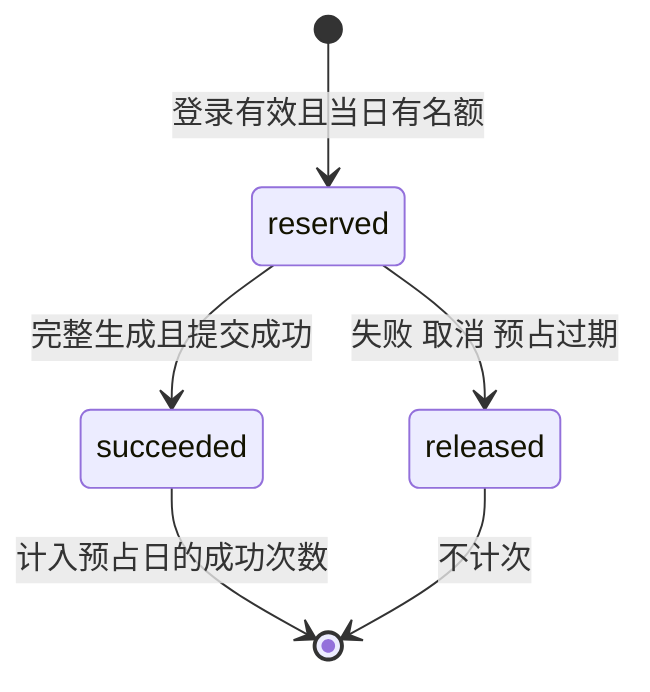

# SaveAny 用户与 AI 额度子系统——方案设计文档

本方案在现有 Vue 3 + FastAPI 架构中加入账号和每日额度，不重写视频下载或模型模块。账号与额度保存在本地 SQLite；请求 AI 前短暂预占名额，完整成功后才计次，失败则释放，既满足失败不扣次，也避免最后一份额度被多个请求同时使用。

日期：**2026-11-01**。对应[子系统需求分析](./【用户与AI额度子系统】需求分析文档.md)。批次一至六及成功结果持久恢复修正已完成，用户已确认“验收通过”；实际实现、测试、体验反馈和清理记录见第 8 章。

## 1. 设计依据与方案选择

原方案第 1～7 节规定了前后端分离、HTTP/SSE、下载封装与模型函数，本次继续沿用。原方案第 8 节只有扩展方向，MVP 开发计划第 8 节才给出扩展优先级，因此本文第 8 章补齐可执行的分阶段计划。

### 1.1 持久化方案比较

账号和额度要在重启后保留，且并发请求不能互相覆盖。用户已确认使用 SQLite；这里记录选择理由，后续不再围绕同一选型反复确认。

| 方案 | 适用性 | 本次结论 |
| --- | --- | --- |
| SQLite + Python 标准库 `sqlite3` | 无独立数据库服务，支持事务，接近参考实现 | ✅ 采用，适合当前本地单实例应用 |
| SQLite + ORM | 适合更复杂的关系模型，但增加依赖和映射代码 | 当前四张表不引入 ORM |
| PostgreSQL 等独立服务 | 适合多实例与更大写入压力，需要运维和迁移方案 | 不纳入本次本地子系统 |

实现按本项目包结构使用相对导入，以 `python -m uvicorn backend.main:app` 启动，不能直接复制参考项目的 `from auth import ...` 等顶层导入。

### 1.2 保留的架构与函数

账号模块负责“能否调用”，字幕和模型模块继续负责“生成什么”。已有名称保持一致，新增函数在第 3 章明确列出，避免开发中另起一套调用方式。

| 既有模块 | 保留名称与行为 |
| --- | --- |
| `backend/main.py` | `parse_video`、`download_video`、`get_direct_url`；对应 `/api/parse`、`/api/download`、`/api/direct-url` |
| `backend/downloader.py` | `VideoDownloader.extract_info`、`download`、`get_url` 与临时文件清理 |
| `backend/api_summarize.py` | `summarize_video`、`chat_with_video`；保留请求原有字段，包括问答 `history` |
| `backend/summarizer.py` | `SubtitleExtractor.extract`；`VideoSummarizer.summarize_stream`、`generate_mindmap`、`chat_stream` |
| 前端 AI API | `summarizeVideo`、`chatWithVideo`、`handleSSEStream`；保持现有参数顺序和取消能力 |
| 前端组件 | `AppHeader`、`VideoResult`、`VideoSummary`、`MindmapView`、`PricingSection`，沿用当前已验收样式 |

## 2. 总体结构与请求流程

浏览器先恢复会话，再决定是否请求 AI。每次 AI 请求都由后端检查会话和额度，浏览器中的邮箱、次数或会员标记都不能替代服务端判断。

```mermaid
flowchart TD
    UI[现有 Vue 首页与工作台] --> AUTH[AuthModal 与共享账号状态]
    AUTH --> AUTHAPI[/api/auth/register login me logout]
    UI --> AIAPI[/api/summarize 与 /api/chat]
    AIAPI --> LOGIN[auth.get_current_user]
    LOGIN --> QUOTA[额度预占依赖]
    AUTHAPI --> DB[(SQLite: 用户 会话 额度请求)]
    LOGIN --> DB
    QUOTA --> DB
    QUOTA --> SUB[SubtitleExtractor.extract]
    SUB --> MODEL[VideoSummarizer 既有方法]
    MODEL --> RESULT{完整成功?}
    RESULT -->|是| COMMIT[成功计次]
    RESULT -->|否或中断| RELEASE[释放未成功的预占]
    COMMIT --> DB
    RELEASE --> DB
    COMMIT --> SSE[quota 与 done 事件]
    RELEASE --> ERROR[error 或客户端取消]
    UI --> VIDEO[既有视频解析与下载接口]
```

权限或额度拒绝发生在 SSE 响应头发送前；字幕、模型等执行错误发生在流中，使用 `error` 事件。这样前端可以可靠区分“需要登录”“今日用完”和“模型暂时失败”。

## 3. 文件职责与函数约定

参考项目的 `database.py`、`auth.py` 和 `api_auth.py` 保持相同职责与常用名称。额度是独立业务，新增一个小模块处理；不引入通用仓储、工厂、基类或多层包装。

### 3.1 后端新增与修改

| 文件 | 主要函数/类型 | 职责 |
| --- | --- | --- |
| 新增 `backend/database.py` | `get_db_path()`、`get_db()`、`init_db()` | 文件路径、短生命周期连接与建表；不加载真实测试数据 |
| 同上 | `get_user_by_email(email)`、`get_user_by_id(user_id)`、`create_user(email, password_hash)` | 参数化 SQL 和用户持久化；邮箱唯一约束为最终查重依据 |
| 同上 | `get_summary_result(user_id, url, language)`、`save_summary_result(db, user_id, result, now)` | 查询本人成功结果；保存复用计次事务连接 |
| 同上 | `create_session(user_id, expires_at)`、`get_session(session_id)`、`revoke_session(session_id)` | 登录会话与当前会话撤销 |
| 新增 `backend/auth.py` | `hash_password(password)`、`verify_password(password, hashed)` | bcrypt 哈希与校验；不做业务额度处理 |
| 同上 | `create_token(user_id, session_id)`、`decode_token(token)`、`get_current_user(...)` | JWT 签名、验证与必需登录依赖，返回本人身份与会话信息 |
| 新增 `backend/api_auth.py` | `RegisterRequest`、`LoginRequest`；`register`、`login`、`get_me`、`logout`、`get_quota` | 账号 HTTP 边界、对外用户字段、额度查询路由 |
| 新增 `backend/quota.py` | `QuotaKind = Literal['summary', 'chat']`；`UsageReservation` | 额度种类和预占结果；结果包含 `request_id/user_id/kind/quota_date/expires_at` |
| 同上 | `get_quota(user_id)`、`reserve_usage(user_id, kind)`、`commit_usage(request_id, *, summary_result=None)`、`release_usage(request_id)`、`release_expired_usage()` | 两项额度查询、预占、正式计次、失败释放与过期恢复 |
| 同上 | `reserve_summary_usage(...)`、`reserve_chat_usage(...)` | 两个明确的 FastAPI yield 依赖；先检查并预占，响应退出时释放未成功记录 |
| 修改 `backend/main.py` | `lifespan`、路由挂载、HTTP 错误处理 | 启动校验 JWT 配置并建表；挂载账号路由；允许认证头；过期预占清理接现有维护任务 |
| 修改 `backend/api_summarize.py` | `summarize_video`、`chat_with_video` | 接入各自额度依赖；调用既有模型；完整成功时提交额度 |
| 修改运行配置 | `requirements.txt`、`.env.example`、`.gitignore` | 增加认证依赖、数据库路径与 JWT 模板，忽略数据库和 WAL/SHM 文件 |

`get_current_user` 返回明确的已认证用户结构，包含 `id/email/session_id`，内部不重复校验这些字段。新增数据结构只服务本次真实调用，不扩展成通用权限框架。

`api_auth.get_quota` 与 `quota.get_quota` 分别是路由和业务函数；路由使用模块限定名 `quota_service.get_quota(...)` 调用，避免同名导入覆盖。

参考实现的 `check_and_increment_summary` 把权限检查和扣次绑在一起，不适合本次规则，因此不复制、不保留同名假实现；由上表的四个明确动作取代。

### 3.2 前端新增与修改

前端延用 fetch，并把账号和额度状态放在一个共享组合函数中。各组件只触发操作和展示状态，不各自维护一份“是否登录”和“今日次数”。

| 文件 | 函数/职责 |
| --- | --- |
| 新增 `frontend/src/api/auth.js` | `getToken`、`setToken`、`removeToken`、`authHeaders`、`register`、`login`、`fetchMe`、`logout`、`fetchQuota`；名称沿用参考项目，用 fetch 请求本项目接口 |
| 新增 `frontend/src/composables/useAuth.js` | `useAuth` 暴露 `user/quota/authReady/authError/sessionVersion`，以及 `restoreSession/register/login/logout/refreshQuota`；集中处理 Token 变更和失效 |
| 新增 `frontend/src/components/AuthModal.vue` | 登录/注册切换、输入错误、密码显隐、提交中禁用、Esc、焦点恢复；使用现有 dialog 与样式 |
| 修改 `frontend/src/App.vue` | 初始化 `restoreSession`；管理弹窗和当前视频待办；退出或账号变化时清理旧 AI 实例，保留视频信息 |
| 修改 `AppHeader.vue` | 游客登录入口、本人邮箱与退出；手机入口同步 |
| 修改 `VideoSummary.vue` | 等待 `authReady`；登录引导、两项额度、恢复时间、quota 事件与错误分类；保持四标签、导出和多轮问答 |
| 修改 `frontend/src/api/summarize.js` | `stream` 增加同源认证头；错误对象保留 `status/code`；原调用签名不改，不引入 axios |
| 修改 `PricingSection.vue` | 免费权益改为 3 次总结 + 10 次问答；会员继续后续开放 |
| 修改 `frontend/src/style.css` | 只补账号和额度所需样式，保持 16px 正文、现有宽度与手机换行规则 |

`authHeaders()` 只用于本服务 `/api/auth/*` 和受保护 AI 请求，不能附加到第三方视频直链。跨标签页监听 `storage` 事件：Token 变化时先增加 `sessionVersion`、清理旧状态并取消旧 AI，再恢复新身份。

## 4. 数据与认证设计

本次建用户、登录会话、额度请求和成功总结四张表，不建订单或历史列表。会话用于实现真实退出，额度请求同时记录预占与成功，不另外维护容易失去同步的累计计数。

### 4.1 SQLite 表结构

下面是拟实施的首版结构，用于明确字段与约束。所有时间戳统一存 UTC Unix 秒，只有 `quota_date` 存按北京时间换算出的日期；不会把电脑本地时区当作业务时区。

```sql
CREATE TABLE IF NOT EXISTS users (
    id INTEGER PRIMARY KEY AUTOINCREMENT,
    email TEXT NOT NULL UNIQUE,
    password_hash TEXT NOT NULL,
    created_at INTEGER NOT NULL,
    updated_at INTEGER NOT NULL
);

CREATE TABLE IF NOT EXISTS auth_sessions (
    id TEXT PRIMARY KEY,
    user_id INTEGER NOT NULL REFERENCES users(id),
    created_at INTEGER NOT NULL,
    expires_at INTEGER NOT NULL,
    revoked_at INTEGER
);
CREATE INDEX IF NOT EXISTS idx_sessions_user ON auth_sessions(user_id);

CREATE TABLE IF NOT EXISTS ai_usage_requests (
    request_id TEXT PRIMARY KEY,
    user_id INTEGER NOT NULL REFERENCES users(id),
    kind TEXT NOT NULL CHECK (kind IN ('summary', 'chat')),
    quota_date TEXT NOT NULL,
    status TEXT NOT NULL CHECK (status IN ('reserved', 'succeeded', 'released')),
    created_at INTEGER NOT NULL,
    expires_at INTEGER NOT NULL,
    completed_at INTEGER
);
CREATE INDEX IF NOT EXISTS idx_usage_user_day_kind
    ON ai_usage_requests(user_id, quota_date, kind, status);
```

`email` 保存输入校验后去空白并统一大小写的值；`password_hash` 不进入接口响应。会话 ID 与请求 ID 由服务端随机生成，不接受浏览器传入用户 ID、日期、额度或成功状态。额度表不保存链接、问题、字幕、答案或模型密钥。


成功总结按账号、原始链接与总结语言唯一保存。结果中包含字幕、摘要和导图；不包含模型密钥或问答记录。POST 总结成功后用 SQLite UPSERT 替换同一条结果，保存和成功计次共享短事务。[SQLite UPSERT](https://www.sqlite.org/lang_upsert.html)。

```sql
CREATE TABLE IF NOT EXISTS summary_results (
    user_id INTEGER NOT NULL REFERENCES users(id),
    url TEXT NOT NULL,
    language TEXT NOT NULL,
    result_json TEXT NOT NULL,
    updated_at INTEGER NOT NULL,
    PRIMARY KEY(user_id, url, language)
);
```

### 4.2 连接和事务

额度预占需要先把检查和写入放在同一短事务中，不能先查询余额、等待模型、最后再单独加次数。SQLite 的 `BEGIN IMMEDIATE` 可提前取得写入资格；连接采用 `isolation_level=None` 后显式开始、提交或回滚事务。[SQLite 事务说明](https://www.sqlite.org/lang_transaction.html)、[Python 3.11 sqlite3](https://docs.python.org/3.11/library/sqlite3.html)。

- 数据文件默认 `backend/data/app.db`，可由 `DATABASE_PATH` 指定；相对配置统一按项目根目录解析，测试使用临时文件。
- `init_db` 设置 WAL；每个连接启用外键、设置有限的锁等待。默认连接超时 5 秒。
- 一个数据库函数在同一线程内创建、使用并关闭连接；不把全局 connection 在线程池或整个 SSE 生命周期间共享。
- 事务只包含检查与 SQL，不在持锁期间做字幕提取、网络调用或向前端输出。
- `get_db()` 只负责连接和关闭。需要写入的公开操作自己控制事务，使用连接上下文在异常时回滚并继续抛出，不吞掉内部错误。
- 唯一邮箱冲突映射为 409；锁等待超时或数据库不可用在 API 边界映射为 503，不当成额度为零或免费无限。
- 首版没有导入参考项目数据。持久恢复修正仅通过 init_db 新建 summary_results 表，保留已有三张表、账号与额度；这是新增表，不会修改旧字段。旧版本没有保存摘要正文，无法从次数记录还原旧结果。未来改旧表字段仍需明确升级脚本。

### 4.3 密码与登录会话

参考项目使用 bcrypt + PyJWT，本次沿用并补齐退出后的会话检查。签名密钥只由服务器读取，缺少配置时启动给出明确错误，不使用参考代码中的默认开发密钥。

| 项目 | 约定 |
| --- | --- |
| 密码输入 | Pydantic 输入模型中约束 8～50 字符，编码后最多 72 字节；不截断，提示改用较短密码 |
| 哈希 | `bcrypt.hashpw` 与 `bcrypt.gensalt()`；登录用 `bcrypt.checkpw`；同步工作放在线程池中 |
| JWT | HS256，固定解码算法；要求 `sub/jti/iat/exp`；`sub` 为用户 ID 字符串，`jti` 为会话 ID |
| 有效期 | 72 小时，Token 与数据库会话共用到期时间，不做自动刷新 Token |
| 认证 | `HTTPBearer(auto_error=False)` + `get_current_user`；验证签名、到期、用户存在、会话归属且未撤销 |
| 浏览器存储 | `localStorage` 只保存 `saveany_token`，刷新后由 `/me` 恢复用户及额度；不缓存密码或权限结果 |
| 退出 | `POST /api/auth/logout` 撤销当前 `jti`；完成后清理本地 Token。共享同一 Token 的标签页一并退出，其他独立会话不受影响 |

当前 bcrypt 对超过 72 字节的输入会报错，必须在 HTTP 输入处明确处理；PyJWT 解码显式设置算法与必需字段。[bcrypt 官方说明](https://github.com/pyca/bcrypt)、[PyJWT 用法](https://pyjwt.readthedocs.io/en/stable/usage.html)。

邮箱使用 Pydantic `EmailStr` 并安装 `email-validator`。缺字段等基础校验交给框架，本项目不为框架校验单独堆测试。[Pydantic 网络类型](https://docs.pydantic.dev/latest/api/networks/#pydantic.networks.EmailStr)。

## 5. 接口与事件设计

认证接口返回 JSON，AI 正常执行继续返回既有 SSE。错误增加稳定的 `code` 供页面决定下一步，中文提示供用户理解；前端无需从某一句错误文案猜测是否该打开登录框。

### 5.1 账号接口

| 方法与路径 | 路由函数 | 输入 | 成功结果 |
| --- | --- | --- | --- |
| `POST /api/auth/register` | `register` | `{email, password}` | 201，`data: {token, token_type:'bearer', user, quota}`，自动登录 |
| `POST /api/auth/login` | `login` | `{email, password}` | 200，同注册成功结构，创建新会话 |
| `GET /api/auth/me` | `get_me` | Bearer | 200，`data: {user, quota}` |
| `POST /api/auth/logout` | `logout` | Bearer，无请求体 | 200，`data: {logged_out:true}` |
| `GET /api/auth/quota` | `get_quota` | Bearer | 200，`data` 为本人两项额度快照 |
| `GET /api/summarize/result` | `get_summary_result` | Bearer；query: url、language（默认 zh） | 200，`data` 为本人保存的 {subtitle,summary,mindmap,saved_at}；没有记录时为 null，不占额度 |

所有成功 JSON 外层为 `{"success":true,"data":...}`。首版 `user` 只返回 `{id,email}`，不暴露密码哈希、内部会话字段或虚构会员权益；不要直接复制参考前端对 `res.data.data` 的 axios 访问方式。

### 5.2 额度快照

页面同时显示“成功用了多少”和“当前还能发起多少”，执行中的预占不算已经成功消耗。以下是一次总结成功后、没有执行中任务的例子，时间仅为说明结构。

```json
{
  "date": "2026-11-01",
  "timezone": "Asia/Shanghai",
  "server_time": "2026-11-01T12:00:00+08:00",
  "reset_at": "2026-11-02T00:00:00+08:00",
  "summary": {"limit": 3, "used": 1, "reserved": 0, "remaining": 2},
  "chat": {"limit": 10, "used": 0, "reserved": 0, "remaining": 10}
}
```

`used` 统计当天成功记录，`reserved` 统计当天尚未到期的预占，`remaining = limit - used - reserved`。查询只接受登录身份，不接受查询别的 `user_id`。页面在登录恢复、请求结束、重新获得焦点和到达 `reset_at` 时刷新；刷新失败显示额度暂不可用，不当成无限次数。

### 5.3 错误格式

统一处理 HTTP 业务错误，保留现有 `success/error` 外层习惯，增加 `code` 与需要时的额度信息。已有下载与参数校验行为保持兼容，不用宽泛异常捕获把程序错误伪装成模型失败。

```json
{
  "success": false,
  "code": "AUTH_REQUIRED",
  "error": "请先登录后使用 AI 功能"
}
```

| HTTP 状态 | code | 场景与页面动作 |
| --- | --- | --- |
| 401 | `AUTH_REQUIRED` | 无 Token，显示登录引导；包含 `WWW-Authenticate: Bearer` |
| 401 | `SESSION_INVALID` | Token 无效、过期或会话撤销；清理账号状态，保留视频信息 |
| 401 | `INVALID_CREDENTIALS` | 登录邮箱或密码错误，只在表单显示，不影响当前视频 |
| 409 | `EMAIL_EXISTS` | 邮箱已注册，提示切换登录 |
| 422 | `VALIDATION_ERROR` | 输入不符合要求，显示对应可读提示 |
| 429 | `QUOTA_EXHAUSTED` | 当天成功次数达到上限，返回 quota 快照与恢复时间 |
| 429 | `QUOTA_BUSY` | 剩余名额被其他执行中请求预占，提示等待后刷新 |
| 503 | `ACCOUNT_SERVICE_UNAVAILABLE` | 数据库锁超时或不可访问，提示重试，不绕过认证与额度 |

这些状态由 API 边界映射，数据库内部与模型内部只处理自己已知的错误。项目现有 `VideoError` 仍用于字幕与模型已约定的可恢复错误。

### 5.4 总结与问答 SSE

`/api/summarize` 保留 `{url,language}`，`/api/chat` 保留 `{url,question,subtitle_text,history}`。新增 `Authorization: Bearer ...` 请求头，不改用 URL 传 Token，也不换成无法设置该头的浏览器原生 EventSource。

| 接口 | 成功事件顺序 | 成功标准 |
| --- | --- | --- |
| 总结 | `subtitle → summary... → mindmap → quota → done` | 摘要正常结束、非空导图返回、额度提交成功 |
| 问答 | `answer... → quota → done` | 回答正常结束且非空、额度提交成功 |
| 已开始后的失败 | 可有部分内容，最后 `error`；没有 `done` | 不把部分输出当完成；未成功预占由退出清理释放 |

`quota` 的 data 是第 5.2 节完整快照。既有 `subtitle/summary/mindmap/answer` 数据格式不变，`done` 仍是 `[DONE]`；`ServerSentEvent(data=...)` 自动编码 JSON，只有结束哨兵使用 `raw_data='[DONE]'`，避免双重编码。[FastAPI SSE](https://fastapi.tiangolo.com/tutorial/server-sent-events/)。

`error` data 为 `{code,message}`，字幕/模型失败分别使用 `NO_SUBTITLE`、`AI_FAILED`，额度结算失败使用 `QUOTA_COMMIT_FAILED`。结算失败时不发送 `done`；前端在失败与取消后的下一次可用时机刷新额度。流开始后不再尝试修改 HTTP 状态。

## 6. 额度预占、成功计次与释放

不能把“成功后计次”写成生成完才检查余额，否则两个同时开始的请求都可能认为自己还有最后一次机会。本方案先预占名额，完整生成后把同一条记录改为成功，失败则改为释放；这不是提前扣正式次数。

### 6.1 状态与关键操作

每个请求只对应一条服务端生成的记录。状态只能从 `reserved` 变成 `succeeded` 或 `released`，已经成功的记录不会被退出清理误改成释放。



| 函数 | 必须完成的动作 |
| --- | --- |
| `get_quota(user_id)` | 计算服务端北京时间日期，按两种 kind 汇总当天成功与有效预占；返回服务器时间和下次零点 |
| `reserve_usage(user_id, kind)` | 短事务 `BEGIN IMMEDIATE`；释放过期预占；计算 `used + reserved`；不足则拒绝，否则插入一条 reserved 后提交 |
| `commit_usage(request_id, *, summary_result=None)` | 短事务中更新尚未到期的 reserved 为 succeeded；总结同时保存成功结果，再准备当前额度快照。两者一起提交；保存失败则一起回滚，返回 error，不发送 done |
| `release_usage(request_id)` | 仅把 reserved 改为 released；成功记录不变；重复清理不重复扣次或退款 |
| `release_expired_usage()` | 把已到期 reserved 改为 released；启动、周期维护和新预占时执行 |

`commit_usage` 对已成功的同一请求返回已完成结果，不新增计数；对已释放或过期请求拒绝成功结算。请求 ID 不用于跨 HTTP 重试缓存：用户主动重新生成的成功请求仍计新一次；GET 读取保存结果不预占、不计次，网络最后阶段的结算结果可通过额度查询确认。

### 6.2 时间、异常与中断

日期采用 `ZoneInfo('Asia/Shanghai')`，Windows 运行依赖显式加入 `tzdata`。固定预占有效期为 **15 分钟**，在每次进入模型阶段和流式输出循环检查期限；超时后停止后续阶段，不允许结算为成功。[Python zoneinfo](https://docs.python.org/3.11/library/zoneinfo.html)。

| 情况 | 处理方式 |
| --- | --- |
| 无字幕、缺模型密钥、摘要失败或导图失败 | 沿用现有可读错误；释放预占，已收到字幕可继续导出 |
| 客户端取消或断开 | 结束时释放未成功预占，关闭模型流；已发送的同步网络调用可能要等其超时返回，不能承诺即时取消提供商计费 |
| 后端进程崩溃 | 启动时释放已过期预占；未到期预占继续显示处理中，到期后恢复，不把成功记录清零 |
| 跨零点 | 旧请求保留旧 quota_date；quota 事件返回当前日期的快照，不把旧日扣次混入新日 |
| 锁超时或结算失败 | 不发送成功结束；记录真实服务错误，清理未成功预占，前端提示重试并查询余额 |

预占依赖在 `yield` 前完成认证和预占，使用 request 范围，使退出清理覆盖流响应；依赖内部不保持数据库连接。两个 AI 路由继续 yield `ServerSentEvent`，同步模型与字幕工作按现有线程池方式执行，不阻塞事件循环。[FastAPI yield 依赖范围](https://fastapi.tiangolo.com/tutorial/dependencies/dependencies-with-yield/)。

实际断开测试发现，同步线程正在执行时不会立刻被取消。实现使用 `anyio.from_thread.check_cancelled()` 在阶段边界及结算前确认请求仍有效，并由 request 范围的 `stream_resources()` / `ExitStack` 明确关闭模型和 token 生成器，不依赖垃圾回收。数据库短暂锁定时，周期维护记录错误并下一轮重试，原下载文件清理继续执行。[AnyIO 线程取消说明](https://anyio.readthedocs.io/en/stable/threads.html#reacting-to-cancellation-in-worker-threads)。

15 分钟是异常恢复期限，不是承诺视频一定在 15 分钟内完成。若第三方调用迟迟不返回，过期清理仍能恢复名额；迟到任务不得提交成功，也不继续下一次模型调用。

## 7. 页面交互与精简测试

先给用户看真实账号样品，再把额度接入完整 AI 路径。界面沿用现有工作台和弹窗样式，不为本子系统重做首页或新增管理后台。

### 7.1 页面状态与防止串内容

`authReady` 区分“尚未恢复”与“已确认游客”。每次账号变化增加 `sessionVersion`，AI 回调同时核对当前视频、请求序号和会话版本，避免退出或更换账号后写入旧结果。

| 状态 | 页面行为 |
| --- | --- |
| 恢复身份中 | 视频照常解析；AI 显示准备，不发送匿名总结请求 |
| 游客 | 显示登录后生成；点击后打开弹窗并记录当前 URL 的一次待办 |
| 已登录 | 先查询本人保存结果；有结果免费恢复，不要求剩余额度；确实无结果时才按首次自动总结规则启动一次 |
| 恢复查询失败 | 显示“重试恢复”，不自动转换为生成；主动重新总结失败保留上次成功结果 |
| 成功 | 更新对应额度；另一项不变化，显示已整理完成或回答完成 |
| 生成失败或断流 | 保留当前账号的部分结果；服务端确认失败时说明不计次，断流时先刷新实际余额，不仅凭缺少 done 宣称未扣次 |
| 次数用尽 | 展示该项恢复时间；保留下载与已有内容，不引导虚假开通 |
| 退出或账号切换 | 先取消旧请求、清理 AI 内容和待办，再恢复新账号；不取消独立的视频下载 |

登录成功不重复触发 `onMounted` 和待办两条总结路径；以同一请求状态入口合并。页头直接登录也只对当前 URL 决定一次，登录途中切换视频时旧待办作废。

### 7.2 测试原则与用例

后端使用现有 pytest 与 FastAPI 测试客户端；账号和额度使用真实临时 SQLite 文件，模型、字幕网络和视频平台通过现有边界 mock 隔离。每个核心模块保留 1 个正常流程与 1～2 个明确异常测试，不为哈希辅助函数、配置读取或框架必填校验另建测试。

| 核心功能与文件 | 正常主流程 1 个 | 异常/降级 1～2 个 |
| --- | --- | --- |
| 注册：`tests/test_auth.py` | `test_register_creates_account_and_session`：真实建号、自动登录、无敏感返回字段 | `test_register_duplicate_email`：大小写归一后的重复邮箱 409 |
| 登录：同上 | `test_login_restores_persisted_account`：重新创建应用上下文仍能登录同一账号 | `test_login_wrong_credentials`：不存在邮箱/错误密码使用同一错误，不发 Token |
| 会话：同上 | `test_session_me_logout_and_replay`：查询本人、退出、旧 Token 被拒绝 | `test_session_invalid_or_expired`：无效或过期 Token 401；`test_sessions_are_independent`：撤销一份不撤销另一份 |
| 额度：`tests/test_quota.py` | `test_quota_lifecycle_and_user_isolation`：两项独立、预占/成功/释放和另一用户隔离 | `test_last_slot_concurrent_reservations`：真实数据库两个连接抢最后名额；`test_midnight_and_expired_reservation`：跨日归属及崩溃遗留恢复 |
| 总结：调整 `tests/test_ai.py` | 现有总结主流程加认证、quota 顺序与只计一次的断言 | 无字幕不计次；模型/导图失败不计次、不发送 done，复用已有模型故障 mock |
| 问答：调整同上 | 现有多轮上下文主流程加认证、只减少 chat 额度 | 模型失败不计次；问答额度用尽直接拒绝且不调用模型 |
| AI 权限：同上 | 已登录成功由上面主流程覆盖 | 一个共同用例验证匿名直接请求 summarize/chat 都是 401，字幕和模型均未调用 |

额度测试只测上述公开业务动作，不逐个测试 SQL、索引或内部日期格式化。模型输出异常只参数化已有明确失败类型，不穷举任意对象类型来增加数量。

前端沿用 Node 内置测试：`frontend/tests/auth.test.js` 覆盖登录请求、401 清理和会话恢复；调整 `summarize.test.js` 覆盖认证头、quota 事件及中途断流，保留 `video.test.js` 的直链与代理回退。弹窗、切换账号、断线与布局通过浏览器和人工操作验证，不为样式添加镜像测试。

## 8. 分阶段开发计划：批次一至批次六

这六批完成 MVP 扩展优先级第一项。每批先按对应业务行为写一个失败测试，确认失败原因，再写最小实现并运行相关回归；涉及页面的批次同时给出可体验样品。下方复选框与实际验证同步，技术验证与用户体验分别记录。

| 批次 | 对应需求 | 对照原方案/MVP | 直接依赖 |
| --- | --- | --- | --- |
| 一：账号接口与数据可保存 | R1、R2、R6～R8 | 原方案 1/2/6/8；MVP 扩展 1 | 用户确认本文步骤 |
| 二：能真实注册登录和退出——首个样品 | R1、R2、R5、R9 | 原方案 5/6；原型账号流程 | 一 |
| 三：能准确查询、预占与结算两项额度 | R3、R6、R10 | 原方案 3/8；MVP 扩展 1 | 一 |
| 四：AI 接口由服务端检查并成功计次 | R3、R4、R10 | 原方案 3.4/3.5/7.2/7.3 | 三 |
| 五：登录后继续当前视频，页面看见真实额度 | R2、R4、R5、R9 | 原方案 5/7.4；已验收工作台 | 二、四 |
| 六：联调、人工验收与清理 | R10、R11 | 原需求 4；MVP 验收与清理约定 | 五 |

默认按一到六顺序执行；二和三在技术上可独立，但本任务采用单助手逐批推进。六批之外的扩展见第 9 章，每项仍需另行确认范围。

### 批次一：账号接口与数据可保存

先把真实账号基础做稳，后面前端和额度才有可信的用户身份。此批不改已有 AI 的权限行为，阶段服务只用于本地开发验证。

- [x] 编写 `tests/test_auth.py` 的注册、登录与会话核心用例；在 `tests/conftest.py` 设置临时 `DATABASE_PATH` 和测试专用 `JWT_SECRET`，继续禁止加载真实 `.env`。
- [x] 运行失败测试，确认缺少账号路由或数据模块导致失败，排除环境安装问题。
- [x] 新增 `database.py`、`auth.py`、`api_auth.py`，完成第 3～5 章账号部分；`init_db` 一次建立三张表，额度表暂不写业务数据。
- [x] 修改 `main.py` 生命周期、认证路由挂载和业务错误处理；CORS 方法增加本轮需要的能力，请求头明确包含 `Content-Type/Authorization`，继续使用现有明确来源。
- [x] 新增依赖 `bcrypt`、`PyJWT`、`email-validator`、`tzdata`，安装时核对兼容版本并锁定实际通过的版本；不升级无关下载与渲染依赖。
- [x] `.env.example` 增加 `JWT_SECRET`、`DATABASE_PATH`，`.gitignore` 忽略 `backend/data/`；实际 `.env` 不覆盖、不复制参考项目配置。
- [x] 运行账号测试与既有视频回归，通过真实页面与 HTTP 接口完成注册→me→logout→旧 Token 拒绝；`/docs` 已可访问，供人工复验。

运行命令：`.venv/Scripts/python.exe -m pytest tests/test_auth.py tests/test_video.py -q`。完成依据是账号数据保留、真实会话可撤销、原下载测试通过，不以“接口返回了一个字符串”代替认证验证。

### 批次二：能真实注册登录和退出——首个样品

把已有“后续开放”的登录入口替换为真实表单，让用户尽早检查操作是否顺手。此时额度 UI 和 AI 服务端拦截尚未接入，样品应明确标注这一阶段边界。

- [x] 新增 `frontend/src/api/auth.js`、`composables/useAuth.js` 与 `AuthModal.vue`，实现恢复会话、注册登录和服务端退出。
- [x] 修改 `App.vue`、`AppHeader.vue` 与少量样式，接入共享身份和手机账号入口；阶段中 `/me` 只需要身份，额度在批次三接入后补齐。
- [x] 用 `frontend/tests/auth.test.js` 检查请求路径、Bearer、恢复失败与退出清理，保留已有前端回归。
- [x] 浏览器展示真实注册→刷新恢复→退出样品；确认邮箱可读、弹窗顺序、错误信息、Esc 与键盘焦点、375px 布局。
- [x] 取得用户对账号样品的反馈，再大幅展开批次五的完整页面接入；不依赖该反馈的后端额度工作可继续。

在 `frontend` 目录运行 `npm.cmd test`、`npm.cmd run build`。此样品创建真实本地账号，无模拟账户或支付；不会把原型演示额度当成服务端数据。

### 批次三：能准确查询、预占与结算两项额度

这一批完成费用相关的核心规则。先用真实临时 SQLite 验证并发和换日，再连接模型，避免依靠页面禁用按钮掩盖后端竞态。

- [x] 编写 `tests/test_quota.py` 的三个业务用例，使用两个独立数据库连接争抢最后一个名额；通过 monkeypatch 替换模块时间来源验证北京时间换日，不修改系统时间。
- [x] 运行失败测试，再新增 `quota.py` 的查询、预占、提交、释放和过期清理函数。
- [x] 实现 `GET /api/auth/quota`，将 `me` 与注册登录结果补齐额度快照；补齐前端 `fetchQuota/refreshQuota`。
- [x] 验证同一请求重复结算只计一次、成功记录不会被释放、跨午夜按预占日结算；这些断言放入主流程或换日测试，不新增零碎测试。
- [x] 将过期预占恢复接到启动与现有周期维护流程，新预占前同样处理过期记录。
- [x] 运行账户、额度与视频回归，核对两账号互不影响和重启保留数据。

运行命令：`.venv/Scripts/python.exe -m pytest tests/test_auth.py tests/test_quota.py tests/test_video.py -q`。本批不调用真实 DeepSeek。

### 批次四：AI 接口由服务端检查并成功计次

现在把已验证的身份和额度接到两个现有 AI 入口。保留模型类和事件数据，只增加前置依赖、成功结算和 quota 通知。

- [x] 先调整现有 AI 测试：通过真实测试账号取 Token；字幕提取单独测试继续无需账号，模型边界继续 mock。
- [x] 编写匿名拒绝、成功计次、失败释放与额度不足用例，运行并确认当前代码确实不能满足新规则。
- [x] 在 `quota.py` 增加 request 范围的 `reserve_summary_usage`、`reserve_chat_usage` yield 依赖；认证和预占发生在流开始前，退出清理不持有连接。
- [x] 修改 `summarize_video`：摘要和导图均成功后提交 summary，再发送 quota/done；失败保留已发送字幕与部分摘要，不结算。
- [x] 修改 `chat_with_video`：保留字幕与 history 处理，正常完整回答后提交 chat，发送 quota/done；不扣 summary 次数。
- [x] 检查模型流关闭、客户端取消、预占过期与数据库故障的恢复路径，内部意外错误继续抛出，清理代码不把错误吞掉。
- [x] 运行完整后端回归；人工通过接口确认 401/429 是普通 JSON，已开始的模型失败是 SSE error。

运行命令：`.venv/Scripts/python.exe -m pytest tests -q`。通过标准是成功事件与数据库记录一致，拒绝请求没有字幕或模型调用，失败没有 done，也没有成功计次。

### 批次五：登录后继续当前视频，页面看见真实额度

后端规则稳定后，完成真实用户路径。完整样品应让用户看到一次总结与一次追问分别扣在哪一项，而不是只展示登录成功提示。

- [x] 修改 `api/summarize.js`，仅为本服务增加认证头，保留 status/code、原有 SSE 分块与取消处理；扩展相应前端测试。
- [x] 修改 `VideoSummary.vue` 和 `App.vue`：等待身份恢复，游客显示登录引导，登录后合并待办与自动总结，避免重复调用。
- [x] 接入两项额度、执行中预占与恢复时间；刷新、窗口重新激活及跨日时向服务端刷新；断网不显示无限额度。
- [x] 区分 401、今日用尽、执行中占用与流式模型失败；退出或切换账号取消旧 AI，请求回调核对 sessionVersion。
- [x] 更新 `PricingSection.vue`、页头和工作台页脚文案；VIP 继续说明后续开放，不提供假开通。
- [x] 展示完整样品：游客下载→登录→总结后 2/10→一次问答后 2/9→退出保留视频；用隔离错误检查失败不扣次与账号切换。
- [x] 运行前端测试、生产构建，浏览器检查桌面、375px、键盘操作与原有字幕/导图导出。

在 `frontend` 目录运行 `npm.cmd test`、`npm.cmd run build`。对新登录和额度体验等待用户反馈后再收尾，自动测试不替代体验确认。

### 批次六：联调、人工验收与清理

最后用少量真实请求确认接口和页面能一起工作，再把实际启动方式与人工验收结果写清楚。模型异常、满额和换日由隔离测试覆盖，不通过反复付费调用制造测试条件。

- [x] 运行完整后端回归、前端测试和生产构建，保存实际输出摘要；不把旧 MVP 的 22/6 测试记录当成本轮结果。
- [x] 使用本项目密钥和有权访问的有字幕视频完成一次真实总结与连续问答，核对两项扣次和同一视频上下文。
- [x] 检查游客下载、无字幕、模型失败、会话过期、两账号隔离；取消与页面切换用浏览器验证，最后额度与服务端查询对齐。
- [x] 更新根目录 `README.md` 的当前范围、JWT/SQLite 配置和实际启动方式；原始三份 docs 保持原样，新指南指向本方案。
- [x] 提供第 10 章格式的人工验收表，请用户验收，记录“符合/有差距/待验证”和依据。
- [x] 用户验收后，仅清理本轮临时脚本、截图、导出样本、缓存和已经废弃的测试替代代码；保留本项目核心回归测试、原型、数据库和运行依赖。
- [x] 核对 diff 与文档对应关系；提交、推送和发布仍需用户明确要求。

清理前先列出具体目标；不按“旧”字样删除仍有业务价值的测试，不删除用户账号数据库，也不修改参考项目。

### 8.1 实际进度与验证记录（2026-11-01）

用户已确认全部六批逐步执行，并在账号样品后回复“符合预期，继续完整页面接入”。批次一至六及持久恢复修正已完成，用户最终回复“验收通过”，约定清理已执行。用户随后要求保存本地 Git 记录，开发分支为 `feature/user-ai-quota`，提交信息以 `git log` 为准；未授权推送或发布。

| 预期 | 实际结果 | 状态与依据 |
| --- | --- | --- |
| 账号注册、登录、恢复和真实退出 | SQLite 保存账号，会话共用 72 小时到期点；退出后旧 Token 401，独立会话不受影响 | 符合；真实临时库测试、真实浏览器注册/刷新/退出及重启复验 |
| 首个账号样品可用 | 登录/注册切换、密码显隐、Esc、焦点返回、375px 无横向溢出 | 用户已确认符合预期；独立 Edge 浏览器检查通过 |
| 两项额度、并发和北京时间换日 | 总结 3 / 问答 10 独立；最后名额只有一个预占成功；跨日按预占日结算；过期任务不能成功提交 | 符合；真实 SQLite 并发与替换模块时间的隔离测试 |
| 失败、断开不计次 | 无字幕、无密钥、模型或导图失败释放预占；同步模型等待期间断开也不成功计次，模型流和客户端明确关闭 | 符合；两种真实 ASGI 断开回归通过，周期数据库锁故障可恢复 |
| 登录后只继续一次、账号变化不串内容 | 游客没有 AI 请求；登录后当前视频只生成一次；退出保留视频、清空 AI；跨标签页同步 | 符合；隔离页面检查与真实跨标签页退出复验 |
| 真实总结和连续问答 | 官方 Plyr 演示页真实字幕 → DeepSeek 摘要和导图 → 两轮问答 | 符合；最终总结 used=1 / remaining=2，问答 used=2 / remaining=8，两项 reserved=0；第二轮沿用人物上下文并说明字幕没有给出岛名 |
| 游客下载不受账号影响 | Plyr 首个 MP4 实际保存 49,900,386 字节，183.125 秒，H.264 720×576 + AAC；游客 AI 请求为 0 | 符合；真实浏览器下载与 ffprobe；W3C 旧样例本轮遇平台 403，保留错误事实并使用可用替代样例 |
| 现有字幕与导图导出可用 | SRT 505 字节、SVG 10,795 字节、PNG 4096×1409；桌面和 375px 页面无横向溢出 | 符合；实际文件导出、PNG 文件头和截图检查；其他字幕格式实现未改动 |
| 测试与依赖兼容 | 后端 43 项、前端 15 项通过，生产构建成功，pip check 无损坏依赖 | 符合；不加载真实 .env 的隔离回归。导图库仍有原有大包提示，不影响构建 |
| 原资源与配置保护 | 原始三份 docs 的 SHA-256 与 MVP 记录一致；参考项目只读；本机只补齐缺失 JWT_SECRET/DATABASE_PATH，未替换模型配置 | 符合；Git 差异与文件校验。代理 Fake-IP 兼容仅在本轮本地服务进程显式开启 |
| 最终体验与清理 | 用户已确认“验收通过”；清理本轮验证文件、导出副本、独立测试数据库及缓存，共 52 个文件、51,967,126 字节 | 符合；真实账号/额度/总结数据库、核心回归测试、原型与运行依赖保留，独立测试浏览器已关闭 |

用户随后明确说明现有账号均为测试账号，可一并清除。确认没有进行中的 AI 请求后，在同一事务清空 4 个测试账号、7 个登录会话、6 条额度请求及 1 份成功总结结果，保留数据库文件和四张业务表结构；各表记录数已验证为 0，SQLite 完整性检查通过。页面中的旧 Token 已失效，后续使用需重新注册或登录新账号。

只读审查提出的取消扣次、资源延迟关闭、后台数据库故障、额度响应乱序和旧登录响应覆盖问题均已补充失败复现、修复并复核通过。正式代码沿用现有函数和模块，额外的 ExitStack 仅用于请求资源关闭，不引入通用包装层。

本轮 Context7 MCP 与沙箱外 CLI 均连接失败，已直接核对官方 FastAPI、Vue、PyJWT、bcrypt、Pydantic、sqlite3、zoneinfo 和 AnyIO 文档。新依赖实际验证版本为 bcrypt 5.0.0、PyJWT 2.15.1、email-validator 2.3.0、tzdata 2026.6；保留原有框架和下载依赖版本。

### 8.2 验收反馈修正：重登免费恢复

用户反馈“退出重登会再次总结扣次”，随后确认按账号持久保存成功结果。本次新增 summary_results 表和本人查询接口，页面先恢复再决定是否首次生成。主动重新总结成功才更新结果与计次；失败在数据库及当前页面都保留上次成功结果。游客与其他账号无法读取。

新增三个后端核心用例覆盖重登/应用重启/账号隔离、失败保留与主动更新、保存故障回滚次数；两个前端 API 用例覆盖认证查询和服务故障不当成无结果。技术验证更新为后端 43 项、前端 15 项通过，构建成功。独立浏览器已验证：同账号连续退出重登三次只发生一次首次生成，重登不重复解析；刷新免费恢复，主动重新总结失败保留旧结果，随后主动生成成功才增加一次用量。浏览器使用真实本地账号、SQLite 和额度服务，模型与视频边界隔离，未额外调用真实模型。修正后用户已确认“验收通过”，临时材料清理完成。

## 9. 其余扩展路线：批次七至批次十三

2026-11-01 用户调整剩余七项扩展的顺序。本节同步新顺序，已验收的一至六批及其记录保持原样；各项完整需求、接口、数据升级和多 Agent 分工改见[剩余扩展总计划](./【剩余扩展】总计划与阶段记录.md)、[需求与验收](./【剩余扩展】需求与验收.md)和[接口与数据方案](./【剩余扩展】接口与数据方案.md)。总计划尚待确认，不把路线视为已经实现。

| 批次 | 对应 MVP 优先级/原方案 | 前置依赖 | 后续具体步骤与可验收成果 |
| --- | --- | --- | --- |
| 七：下载与总结历史（S1） | 当前扩展1；原方案8历史 | 已验收一至六 | 直接列出现有summary_results，下载只保存元信息；本人详情/删除；不依赖重新解析、不重复总结扣次 |
| 八：Docker 本地容器化（S2） | 当前扩展2；原方案8 Docker | 七稳定成果；按序交付 | 本地构建与代理、SQLite整目录持久卷、ffmpeg、停启数据保留；不自动发布 |
| 九：批量下载与任务队列（S3） | 当前扩展3；原方案8批量 | 稳定下载/账号/七的数据；八先交付 | 持久任务、限并发、失败隔离、协作取消、手动重试、24小时文件领取 |
| 十：WebSocket 真实进度（S4） | 当前扩展4；原方案8进度 | 九的任务身份/归属/快照 | hook真实字节和阶段→授权订阅→断线查询恢复；不造假百分比，不替换AI SSE |
| 十一：字幕翻译（S5） | 当前扩展5；原方案8字幕 | 本人保存字幕、九的任务；十先交付 | DeepSeek逐段翻译、独立额度、时间戳/导出、成功缓存、失败保留原文/旧译文 |
| 十二：无字幕转写（S6） | 当前扩展6；原方案8 Whisper | 九的队列/空间预算、十一字幕与独立额度 | 显式本地CPU转写；单条30分钟、免费日60/VIP日240分钟；成功字幕可显式供总结使用 |
| 十三：VIP 与支付（S7） | 当前扩展7；原方案8付费 | 账号和四项额度明确、十二先交付 | Stripe测试Checkout与签名回调、并发重复不重复授予、服务端权益；暂无测试账号，真实联调待配置；不执行真实扣款 |

实线顺序是用户要求的交付顺序，不代表全部技术依赖；缺外部环境时可推进后续独立可验证工作，但前阶段缺口继续标受阻，不能假报全部通过。后续关键范围变化仍先确认。

## 10. 本地启动与手工验收方法

以下是子系统实施完成后应执行的步骤，当前文档交付并不代表新接口已经可用。实际安装版本、测试输出及浏览器结果需在批次六补充，不能预填为通过。

### 10.1 环境与配置

保留当前 Python 3.11、Node 22.12+ 和 ffmpeg 运行方式。先安装后端依赖，创建 JWT 密钥，再重启后端；SQLite 会自动创建新表，无需单独安装数据库服务。

```powershell
# 在项目根目录执行；实施后 requirements 才包含新增依赖
.venv/Scripts/python.exe -m pip install -r backend/requirements-test.txt

# 仅在 .env 不存在时创建，已有 DeepSeek 配置不要覆盖
if (!(Test-Path backend/.env)) { Copy-Item backend/.env.example backend/.env }

# 只在本机生成，填入 backend/.env 的 JWT_SECRET；不要发送到聊天
.venv/Scripts/python.exe -c "import secrets; print(secrets.token_urlsafe(48))"
notepad backend/.env
```

配置模板应包含以下新增字段；占位值不是可直接使用的生产密钥。

```dotenv
JWT_SECRET=在本机生成后填写
DATABASE_PATH=backend/data/app.db
```

保留本项目原有 `DEEPSEEK_API_KEY`、`DEEPSEEK_BASE_URL` 和 `DEEPSEEK_MODEL=deepseek-flash`。数据库和环境配置不能从参考项目复制。

终端一从根目录启动后端，终端二启动前端：

```powershell
.venv/Scripts/python.exe -m uvicorn backend.main:app --host 127.0.0.1 --port 8000 --reload --reload-dir backend
```

```powershell
cd frontend
npm.cmd ci
npm.cmd run dev
```

页面地址为 `http://127.0.0.1:5173/`，接口文档为 `http://127.0.0.1:8000/docs`。后端初始化失败时先检查终端配置提示，不通过删除数据库来解决。

### 10.2 人工验收表

先用下载样例确认游客路径，再用已有成功样例验证登录后的 AI 路径。后者是真实模型调用，少量执行即可；满额和换日不需要人工重复消耗次数。

| 步骤 | 你要做什么 | 应该看到什么 |
| --- | --- | --- |
| 1 | 启动两个终端并打开首页 | 页面正常，后端建表成功；无登录时不发送 AI 请求 |
| 2 | 解析 `https://media.w3.org/2010/05/sintel/trailer.mp4` 并下载 | 游客也能下载，AI 提示登录，不弹假会员开通 |
| 3 | 点击登录后生成，注册一个自己记得密码的测试邮箱 | 注册成功进入当前视频，页头显示账号；无字幕不计次 |
| 4 | 解析 `https://raw.githubusercontent.com/sampotts/plyr/v3.7.8/demo/index.html` | 说明完整成功使用 1 次总结额度；字幕、摘要、导图完成后剩余 2 次总结、10 次问答 |
| 5 | 问一个与字幕有关的问题，再连续追问 | 回答正常结束；每轮只减一次问答，总结额度不变 |
| 6 | 完成总结后退出重登三次，再刷新工作台 | 先恢复身份和保存结果，不重复总结、不扣次；退出重登时视频信息保留，不重复解析 |
| 7 | 退出，保留页面视频信息 | 恢复游客引导，旧 AI 内容清空；当前视频仍可下载 |
| 8 | 用刚才 Token 调 `/api/auth/me`，再在另一独立登录会话检查 | 撤销的 Token 返回 401，另一独立会话仍有效 |
| 9 | 退出后注册或登录另一个邮箱 | 额度属于新账号，没有上一账号的摘要和对话 |
| 10 | 重启后端，再登录第一个账号 | 账号和已成功使用次数保留，没有自动重置 |
| 11 | 将页面缩至 375px，并用键盘开关弹窗和切换标签 | 控件可操作，无页面横向溢出，关闭后焦点回到入口 |
| 12 | 查看隔离测试结果中的模型失败、最后名额并发、跨日和过期恢复 | 有明确断言和通过输出；不声称已经真实等待一天或调用几十次模型 |

真实平台访问受网络和平台限制影响，样例不可访问时记录实际错误并换用有权访问的有字幕视频，不伪造结果。人工验收反馈使用“步骤编号 / 预期 / 实际提示”，不要发送密钥或 Token。

## 11. 当前技术资料与版本使用原则

本轮已通过 Context7 先解析库 ID 再查询 FastAPI、Vue 与 PyJWT，并阅读下表官方资料。文档核验日期为 2026-11-01；核验当前用法不等于本次升级所有依赖，开发时优先保留当前项目版本，只锁定本轮实际安装并通过验证的新依赖。

| 技术 | 项目当前声明/新增计划 | 本次核验与使用边界 |
| --- | --- | --- |
| FastAPI | 当前 `0.162.0` | [HTTPBearer](https://fastapi.tiangolo.com/reference/security/)、[SSE](https://fastapi.tiangolo.com/tutorial/server-sent-events/)、[yield 依赖](https://fastapi.tiangolo.com/tutorial/dependencies/dependencies-with-yield/)、[CORS](https://fastapi.tiangolo.com/tutorial/cors/)；认证在流前，清理覆盖响应，允许认证头 |
| Vue | 当前 `^3.5.44` | Context7 解析到 `/vuejs/core` 并查对应版本；[官方共享状态](https://vuejs.org/guide/scaling-up/state-management.html)支持模块级响应状态；本次不为少量状态引入 Pinia |
| Vite | 当前 `^8.3.5` | [官方指南](https://vite.dev/guide/)；沿用现有 Vite 插件与 `/api` 代理、项目 Node 22.12+ 要求 |
| Tailwind CSS | 当前 `^4.3.3` | [Vite 集成](https://tailwindcss.com/docs/installation/using-vite)；沿用 v4 插件，不复制旧方案中的 v3 配置假设 |
| SQLite / sqlite3 | Python 标准库，新增数据文件 | [Python 3.11 sqlite3](https://docs.python.org/3.11/library/sqlite3.html)、[事务](https://www.sqlite.org/lang_transaction.html)；显式短事务、每次操作独立连接，不用 Python 3.12 才新增的连接参数 |
| bcrypt / PyJWT | 新增，参考项目同类依赖 | [bcrypt](https://github.com/pyca/bcrypt)、[PyJWT](https://pyjwt.readthedocs.io/en/stable/usage.html)；Context7 解析 `/jpadilla/pyjwt` 并查询 2.15.1 文档；安装锁定以本机验证为准，不直接写成已安装 |
| Pydantic / email-validator | Pydantic 随现有后端；新增邮箱校验依赖 | [EmailStr](https://docs.pydantic.dev/latest/api/networks/#pydantic.networks.EmailStr)；输入验证只在 HTTP 边界 |
| zoneinfo / tzdata | 标准库 + 新增 Windows 时区数据依赖 | [Python zoneinfo](https://docs.python.org/3.11/library/zoneinfo.html)；显式 Asia/Shanghai，不依赖宿主时区 |
| yt-dlp | 当前 `2026.10.26` | [嵌入用法](https://github.com/yt-dlp/yt-dlp#embedding-yt-dlp)；继续复用现有下载封装，本轮不修改平台解析策略 |
| OpenAI Python SDK / DeepSeek | 当前 SDK `2.54.0`，默认 `deepseek-flash` | [SDK](https://github.com/openai/openai-python)、[DeepSeek](https://api-docs.deepseek.com/)；保留兼容接口、现有模型配置和流关闭方式 |
| marked / DOMPurify / typography | 当前前端依赖 | [marked](https://marked.js.org/)、[DOMPurify](https://github.com/cure53/DOMPurify)；继续清理模型 HTML 并以 prose 渲染，不改已有安全处理 |
| markmap | 当前 lib/view `^0.18.12` | [lib](https://markmap.js.org/docs/packages--markmap-lib)、[view](https://markmap.js.org/docs/packages--markmap-view)；复用转换、渲染、销毁与完整导出能力 |

参考项目原有 6 位密码、默认 JWT 密钥、生成前扣次、无权限问答与 axios 调用方式不直接移植。实现必须服从本文的新规则与本项目实际安装版本。

## 12. 交付检查与继续开发入口

本轮已按确认方案完成账号、额度与成功结果恢复，实际证据见第 8.1、8.2 节。用户验收和约定清理均已完成；批次七至十三仍需另行确认。

| 项目 | 本轮状态 |
| --- | --- |
| 业务范围、SQLite、3/10 独立额度、北京时间换日及成功计次 | 已获用户确认 |
| 源码入口、参考项目差异与原方案映射 | 已完成阅读核对 |
| 官方用法与 Context7 资料 | 本轮 Context7 连接失败，已用官方文档核验；第 8.1、11 章留有资料和记录 |
| 两份子系统文档与一至十三批路线 | 文件清单和一至六批步骤已获用户确认；七至十三仅保留路线 |
| 新增后端/前端实现、数据库初始化、TDD 执行、真实联调 | 已实现并通过技术验证、用户验收和约定清理 |
| 原始 docs、MVP 开发计划与参考项目 | 保持原样 |

本轮已按“失败测试 → 最小实现 → 通过相关回归 → 可体验结果 → 用户反馈”推进。后续修复继续沿用本方案，不重复创建需求来源；提交、推送和发布仍需用户明确要求。
