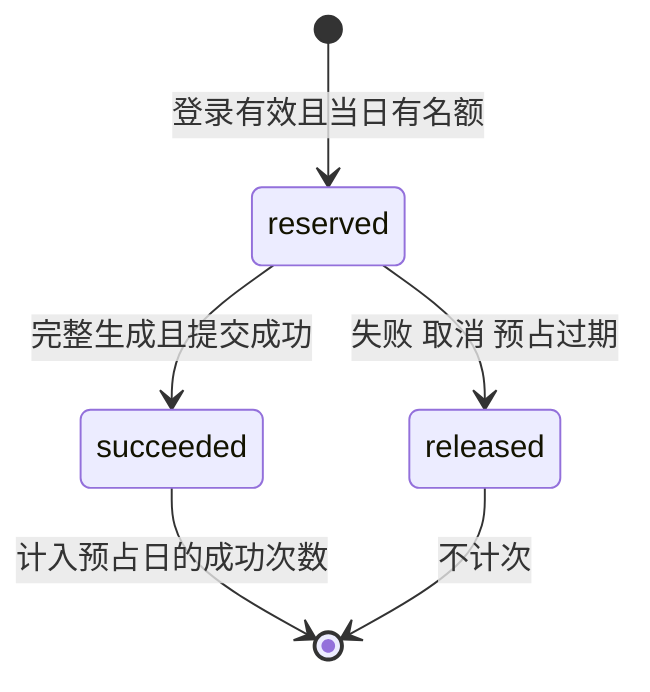

# SaveAny 用户与 AI 额度子系统——方案设计文档

本方案在现有 Vue 3 + FastAPI 架构中加入账号和每日额度，不重写视频下载或模型模块。账号与额度保存在本地 SQLite；请求 AI 前短暂预占名额，完整成功后才计次，失败则释放，既满足失败不扣次，也避免最后一份额度被多个请求同时使用。

子系统需求统一维护在[项目需求分析](./需求分析.md)，本文保留认证、数据结构、额度处理和页面交互的实现细节。

## 1. 设计依据与方案选择

本方案沿用[项目方案设计](./方案设计.md)中的前后端分离、HTTP/SSE、下载封装与模型函数，补充账号认证、SQLite 数据保存和 AI 额度处理的实现方式。

### 1.1 持久化方案比较

账号和额度要在重启后保留，且并发请求不能互相覆盖。用户已确认使用 SQLite；这里记录选择理由，后续不再围绕同一选型反复确认。

| 方案 | 适用性 | 本次结论 |
| --- | --- | --- |
| SQLite + Python 标准库 `sqlite3` | 无独立数据库服务，支持事务，接近参考实现 | ✅ 采用，适合当前本地单实例应用 |
| SQLite + ORM | 适合更复杂的关系模型，但增加依赖和映射代码 | 当前四张表不引入 ORM |
| PostgreSQL 等独立服务 | 适合多实例与更大写入压力，需要运维和迁移方案 | 不纳入本次本地子系统 |

实现按本项目包结构使用相对导入，以 `python -m uvicorn backend.main:app` 启动，不能直接复制参考项目的 `from auth import ...` 等顶层导入。

### 1.2 保留的架构与函数

账号模块负责“能否调用”，字幕和模型模块继续负责“生成什么”。已有名称保持一致，新增函数在第 3 章明确列出，避免开发中另起一套调用方式。

| 既有模块 | 保留名称与行为 |
| --- | --- |
| `backend/main.py` | `parse_video`、`download_video`、`get_direct_url`；对应 `/api/parse`、`/api/download`、`/api/direct-url` |
| `backend/downloader.py` | `VideoDownloader.extract_info`、`download`、`get_url` 与临时文件清理 |
| `backend/api_summarize.py` | `summarize_video`、`chat_with_video`；保留请求原有字段，包括问答 `history` |
| `backend/summarizer.py` | `SubtitleExtractor.extract`；`VideoSummarizer.summarize_stream`、`generate_mindmap`、`chat_stream` |
| 前端 AI API | `summarizeVideo`、`chatWithVideo`、`handleSSEStream`；保持现有参数顺序和取消能力 |
| 前端组件 | `AppHeader`、`VideoResult`、`VideoSummary`、`MindmapView`、`PricingSection`，沿用当前已验收样式 |

## 2. 总体结构与请求流程

浏览器先恢复会话，再决定是否请求 AI。每次 AI 请求都由后端检查会话和额度，浏览器中的邮箱、次数或会员标记都不能替代服务端判断。

```mermaid
flowchart TD
    UI[现有 Vue 首页与工作台] --> AUTH[AuthModal 与共享账号状态]
    AUTH --> AUTHAPI[/api/auth/register login me logout]
    UI --> AIAPI[/api/summarize 与 /api/chat]
    AIAPI --> LOGIN[auth.get_current_user]
    LOGIN --> QUOTA[额度预占依赖]
    AUTHAPI --> DB[(SQLite: 用户 会话 额度请求)]
    LOGIN --> DB
    QUOTA --> DB
    QUOTA --> SUB[SubtitleExtractor.extract]
    SUB --> MODEL[VideoSummarizer 既有方法]
    MODEL --> RESULT{完整成功?}
    RESULT -->|是| COMMIT[成功计次]
    RESULT -->|否或中断| RELEASE[释放未成功的预占]
    COMMIT --> DB
    RELEASE --> DB
    COMMIT --> SSE[quota 与 done 事件]
    RELEASE --> ERROR[error 或客户端取消]
    UI --> VIDEO[既有视频解析与下载接口]
```

权限或额度拒绝发生在 SSE 响应头发送前；字幕、模型等执行错误发生在流中，使用 `error` 事件。这样前端可以可靠区分“需要登录”“今日用完”和“模型暂时失败”。

## 3. 文件职责与函数约定

参考项目的 `database.py`、`auth.py` 和 `api_auth.py` 保持相同职责与常用名称。额度是独立业务，新增一个小模块处理；不引入通用仓储、工厂、基类或多层包装。

### 3.1 后端模块职责

| 文件 | 主要函数/类型 | 职责 |
| --- | --- | --- |
| `backend/database.py` | `get_db_path()`、`get_db()`、`init_db()` | 文件路径、短生命周期连接与建表；不加载真实测试数据 |
| 同上 | `get_user_by_email(email)`、`get_user_by_id(user_id)`、`create_user(email, password_hash)` | 参数化 SQL 和用户持久化；邮箱唯一约束为最终查重依据 |
| 同上 | `get_summary_result(user_id, url, language)`、`save_summary_result(db, user_id, result, now)` | 查询本人成功结果；保存复用计次事务连接 |
| 同上 | `create_session(user_id, expires_at)`、`get_session(session_id)`、`revoke_session(session_id)` | 登录会话与当前会话撤销 |
| `backend/auth.py` | `hash_password(password)`、`verify_password(password, hashed)` | bcrypt 哈希与校验；不做业务额度处理 |
| 同上 | `create_token(user_id, session_id)`、`decode_token(token)`、`get_current_user(...)` | JWT 签名、验证与必需登录依赖，返回本人身份与会话信息 |
| `backend/api_auth.py` | `RegisterRequest`、`LoginRequest`；`register`、`login`、`get_me`、`logout`、`get_quota` | 账号 HTTP 边界、对外用户字段、额度查询路由 |
| `backend/quota.py` | `QuotaKind = Literal['summary', 'chat']`；`UsageReservation` | 额度种类和预占结果；结果包含 `request_id/user_id/kind/quota_date/expires_at` |
| 同上 | `get_quota(user_id)`、`reserve_usage(user_id, kind)`、`commit_usage(request_id, *, summary_result=None)`、`release_usage(request_id)`、`release_expired_usage()` | 两项额度查询、预占、正式计次、失败释放与过期恢复 |
| 同上 | `reserve_summary_usage(...)`、`reserve_chat_usage(...)` | 两个明确的 FastAPI yield 依赖；先检查并预占，响应退出时释放未成功记录 |
| `backend/main.py` | `lifespan`、路由挂载、HTTP 错误处理 | 启动校验 JWT 配置并建表；挂载账号路由；允许认证头；过期预占清理接现有维护任务 |
| `backend/api_summarize.py` | `summarize_video`、`chat_with_video` | 接入各自额度依赖；调用既有模型；完整成功时提交额度 |
| 运行配置 | `requirements.txt`、`.env.example`、`.gitignore` | 增加认证依赖、数据库路径与 JWT 模板，忽略数据库和 WAL/SHM 文件 |

`get_current_user` 返回明确的已认证用户结构，包含 `id/email/session_id`，内部不重复校验这些字段。新增数据结构只服务本次真实调用，不扩展成通用权限框架。

`api_auth.get_quota` 与 `quota.get_quota` 分别是路由和业务函数；路由使用模块限定名 `quota_service.get_quota(...)` 调用，避免同名导入覆盖。

参考实现的 `check_and_increment_summary` 把权限检查和扣次绑在一起，不适合本次规则，因此不复制、不保留同名假实现；由上表的四个明确动作取代。

### 3.2 前端模块职责

前端延用 fetch，并把账号和额度状态放在一个共享组合函数中。各组件只触发操作和展示状态，不各自维护一份“是否登录”和“今日次数”。

| 文件 | 函数/职责 |
| --- | --- |
| `frontend/src/api/auth.js` | `getToken`、`setToken`、`removeToken`、`authHeaders`、`register`、`login`、`fetchMe`、`logout`、`fetchQuota`；名称沿用参考项目，用 fetch 请求本项目接口 |
| `frontend/src/composables/useAuth.js` | `useAuth` 暴露 `user/quota/authReady/authError/sessionVersion`，以及 `restoreSession/register/login/logout/refreshQuota`；集中处理 Token 变更和失效 |
| `frontend/src/components/AuthModal.vue` | 登录/注册切换、输入错误、密码显隐、提交中禁用、Esc、焦点恢复；使用现有 dialog 与样式 |
| `frontend/src/App.vue` | 初始化 `restoreSession`；管理弹窗和当前视频待办；退出或账号变化时清理旧 AI 实例，保留视频信息 |
| `AppHeader.vue` | 游客登录入口、本人邮箱与退出；手机入口同步 |
| `VideoSummary.vue` | 等待 `authReady`；登录引导、两项额度、恢复时间、quota 事件与错误分类；保持四标签、导出和多轮问答 |
| `frontend/src/api/summarize.js` | `stream` 增加同源认证头；错误对象保留 `status/code`；原调用签名不改，不引入 axios |
| `PricingSection.vue` | 显示免费与 VIP 的四项额度，会员入口打开套餐和订单页面 |
| `frontend/src/style.css` | 只补账号和额度所需样式，保持 16px 正文、现有宽度与手机换行规则 |

`authHeaders()` 只用于本服务的账号、AI、历史、任务、字幕和订单等受保护接口，不能附加到第三方视频直链。跨标签页监听 `storage` 事件：Token 变化时先增加 `sessionVersion`、清理旧状态并取消旧 AI，再恢复新身份。

## 4. 数据与认证设计

本节说明账号、登录会话、总结/问答额度和成功总结四张基础表。历史、任务、翻译/转写及订单通过数据库迁移增加，详见[扩展接口与数据方案](./【剩余扩展】接口与数据方案.md)。会话用于实现真实退出，额度请求同时记录预占与成功，不另外维护容易失去同步的累计计数。

### 4.1 SQLite 表结构

下面列出账号基础表及总结结果的结构，字段与约束对应 `database.py` 和 `migrations.py`。所有时间戳统一存 UTC Unix 秒，只有 `quota_date` 存按北京时间换算出的日期；不会把电脑本地时区当作业务时区。

```sql
CREATE TABLE IF NOT EXISTS users (
    id INTEGER PRIMARY KEY AUTOINCREMENT,
    email TEXT NOT NULL UNIQUE,
    password_hash TEXT NOT NULL,
    created_at INTEGER NOT NULL,
    updated_at INTEGER NOT NULL
);

CREATE TABLE IF NOT EXISTS auth_sessions (
    id TEXT PRIMARY KEY,
    user_id INTEGER NOT NULL REFERENCES users(id),
    created_at INTEGER NOT NULL,
    expires_at INTEGER NOT NULL,
    revoked_at INTEGER
);
CREATE INDEX IF NOT EXISTS idx_sessions_user ON auth_sessions(user_id);

CREATE TABLE IF NOT EXISTS ai_usage_requests (
    request_id TEXT PRIMARY KEY,
    user_id INTEGER NOT NULL REFERENCES users(id),
    kind TEXT NOT NULL CHECK (kind IN ('summary', 'chat')),
    quota_date TEXT NOT NULL,
    status TEXT NOT NULL CHECK (status IN ('reserved', 'succeeded', 'released')),
    created_at INTEGER NOT NULL,
    expires_at INTEGER NOT NULL,
    completed_at INTEGER
);
CREATE INDEX IF NOT EXISTS idx_usage_user_day_kind
    ON ai_usage_requests(user_id, quota_date, kind, status);
```

`email` 保存输入校验后去空白并统一大小写的值；`password_hash` 不进入接口响应。会话 ID 与请求 ID 由服务端随机生成，不接受浏览器传入用户 ID、日期、额度或成功状态。额度表不保存链接、问题、字幕、答案或模型密钥。


成功总结按账号、原始链接与总结语言唯一保存。结果中包含字幕、摘要和导图；不包含模型密钥或问答记录。POST 总结成功后用 SQLite UPSERT 替换同一条结果，保存和成功计次共享短事务。[SQLite UPSERT](https://www.sqlite.org/lang_upsert.html)。

```sql
CREATE TABLE IF NOT EXISTS summary_results (
    user_id INTEGER NOT NULL REFERENCES users(id),
    url TEXT NOT NULL,
    language TEXT NOT NULL,
    result_json TEXT NOT NULL,
    updated_at INTEGER NOT NULL,
    result_id TEXT,
    video_title TEXT NOT NULL DEFAULT '',
    platform TEXT NOT NULL DEFAULT '',
    PRIMARY KEY(user_id, url, language)
);
CREATE UNIQUE INDEX idx_summary_result_id ON summary_results(result_id);
CREATE INDEX idx_summary_history
    ON summary_results(user_id, updated_at DESC, result_id DESC);
```

### 4.2 连接和事务

额度预占需要先把检查和写入放在同一短事务中，不能先查询余额、等待模型、最后再单独加次数。SQLite 的 `BEGIN IMMEDIATE` 可提前取得写入资格；连接采用 `isolation_level=None` 后显式开始、提交或回滚事务。[SQLite 事务说明](https://www.sqlite.org/lang_transaction.html)、[Python 3.11 sqlite3](https://docs.python.org/3.11/library/sqlite3.html)。

- 数据文件默认 `backend/data/app.db`，可由 `DATABASE_PATH` 指定；相对配置统一按项目根目录解析，测试使用临时文件。
- `init_db` 设置 WAL；每个连接启用外键、设置有限的锁等待。默认连接超时 5 秒。
- 一个数据库函数在同一线程内创建、使用并关闭连接；不把全局 connection 在线程池或整个 SSE 生命周期间共享。
- 事务只包含检查与 SQL，不在持锁期间做字幕提取、网络调用或向前端输出。
- `get_db()` 只负责连接和关闭。需要写入的公开操作自己控制事务，使用连接上下文在异常时回滚并继续抛出，不吞掉内部错误。
- 唯一邮箱冲突映射为 409；锁等待超时或数据库不可用在 API 边界映射为 503，不当成额度为零或免费无限。
- 结构升级由 `migrations.py` 按版本执行，先创建一致备份，再增加字段和索引，保留已有账号、额度与成功结果。旧版本没有保存摘要正文时，无法从次数记录还原旧结果。

### 4.3 密码与登录会话

参考项目使用 bcrypt + PyJWT，本次沿用并补齐退出后的会话检查。签名密钥只由服务器读取，缺少配置时启动给出明确错误，不使用参考代码中的默认开发密钥。

| 项目 | 约定 |
| --- | --- |
| 密码输入 | Pydantic 输入模型中约束 8～50 字符，编码后最多 72 字节；不截断，提示改用较短密码 |
| 哈希 | `bcrypt.hashpw` 与 `bcrypt.gensalt()`；登录用 `bcrypt.checkpw`；同步工作放在线程池中 |
| JWT | HS256，固定解码算法；要求 `sub/jti/iat/exp`；`sub` 为用户 ID 字符串，`jti` 为会话 ID |
| 有效期 | 72 小时，Token 与数据库会话共用到期时间，不做自动刷新 Token |
| 认证 | `HTTPBearer(auto_error=False)` + `get_current_user`；验证签名、到期、用户存在、会话归属且未撤销 |
| 浏览器存储 | `localStorage` 只保存 `saveany_token`，刷新后由 `/me` 恢复用户及额度；不缓存密码或权限结果 |
| 退出 | `POST /api/auth/logout` 撤销当前 `jti`；完成后清理本地 Token。共享同一 Token 的标签页一并退出，其他独立会话不受影响 |

当前 bcrypt 对超过 72 字节的输入会报错，必须在 HTTP 输入处明确处理；PyJWT 解码显式设置算法与必需字段。[bcrypt 官方说明](https://github.com/pyca/bcrypt)、[PyJWT 用法](https://pyjwt.readthedocs.io/en/stable/usage.html)。

邮箱使用 Pydantic `EmailStr` 并安装 `email-validator`。缺字段等基础校验交给框架，本项目不为框架校验单独堆测试。[Pydantic 网络类型](https://docs.pydantic.dev/latest/api/networks/#pydantic.networks.EmailStr)。

## 5. 接口与事件设计

认证接口返回 JSON，AI 正常执行继续返回既有 SSE。错误增加稳定的 `code` 供页面决定下一步，中文提示供用户理解；前端无需从某一句错误文案猜测是否该打开登录框。

### 5.1 账号接口

| 方法与路径 | 路由函数 | 输入 | 成功结果 |
| --- | --- | --- | --- |
| `POST /api/auth/register` | `register` | `{email, password}` | 201，`data: {token, token_type:'bearer', user, quota}`，自动登录 |
| `POST /api/auth/login` | `login` | `{email, password}` | 200，同注册成功结构，创建新会话 |
| `GET /api/auth/me` | `get_me` | Bearer | 200，`data: {user, quota}` |
| `POST /api/auth/logout` | `logout` | Bearer，无请求体 | 200，`data: {logged_out:true}` |
| `GET /api/auth/quota` | `get_quota` | Bearer | 200，`data` 为本人四项额度及会员状态快照 |
| `GET /api/summarize/result` | `get_summary_result` | Bearer；query: url、language（默认 zh） | 200，`data` 为本人保存的 {subtitle,summary,mindmap,saved_at,result_id}；没有记录时为 null，不占额度 |

所有成功 JSON 外层为 `{"success":true,"data":...}`。首版 `user` 只返回 `{id,email}`，不暴露密码哈希、内部会话字段或虚构会员权益；不要直接复制参考前端对 `res.data.data` 的 axios 访问方式。

### 5.2 额度快照

页面同时显示“成功用了多少”和“当前还能发起多少”，执行中的预占不算已经成功消耗。以下是一次总结成功后、没有执行中任务的例子，时间仅为说明结构。

```json
{
  "date": "2026-11-01",
  "timezone": "Asia/Shanghai",
  "server_time": "2026-11-01T12:00:00+08:00",
  "reset_at": "2026-11-02T00:00:00+08:00",
  "summary": {"limit": 3, "used": 1, "reserved": 0, "remaining": 2},
  "chat": {"limit": 10, "used": 0, "reserved": 0, "remaining": 10},
  "translation": {"limit": 3, "used": 0, "reserved": 0, "remaining": 3, "unit": "requests"},
  "transcription": {"limit": 3600, "used": 0, "reserved": 0, "remaining": 3600, "unit": "seconds"},
  "membership": {"tier": "free", "payment_mode": "test", "expires_at": null}
}
```

`used` 统计当天成功记录，`reserved` 统计当天尚未到期的预占，`remaining = max(0, limit - used - reserved)`。查询只接受登录身份，不接受查询别的 `user_id`。页面在登录恢复、请求结束、重新获得焦点和到达 `reset_at` 时刷新；刷新失败显示额度暂不可用，不当成无限次数。

### 5.3 错误格式

统一处理 HTTP 业务错误，保留现有 `success/error` 外层习惯，增加 `code` 与需要时的额度信息。已有下载与参数校验行为保持兼容，不用宽泛异常捕获把程序错误伪装成模型失败。

```json
{
  "success": false,
  "code": "AUTH_REQUIRED",
  "error": "请先登录后使用 AI 功能"
}
```

| HTTP 状态 | code | 场景与页面动作 |
| --- | --- | --- |
| 401 | `AUTH_REQUIRED` | 无 Token，显示登录引导；包含 `WWW-Authenticate: Bearer` |
| 401 | `SESSION_INVALID` | Token 无效、过期或会话撤销；清理账号状态，保留视频信息 |
| 401 | `INVALID_CREDENTIALS` | 登录邮箱或密码错误，只在表单显示，不影响当前视频 |
| 409 | `EMAIL_EXISTS` | 邮箱已注册，提示切换登录 |
| 422 | `VALIDATION_ERROR` | 输入不符合要求，显示对应可读提示 |
| 429 | `QUOTA_EXHAUSTED` | 当天成功次数达到上限，返回 quota 快照与恢复时间 |
| 429 | `QUOTA_BUSY` | 剩余名额被其他执行中请求预占，提示等待后刷新 |
| 503 | `ACCOUNT_SERVICE_UNAVAILABLE` | 数据库锁超时或不可访问，提示重试，不绕过认证与额度 |

这些状态由 API 边界映射，数据库内部与模型内部只处理自己已知的错误。项目现有 `VideoError` 仍用于字幕与模型已约定的可恢复错误。

### 5.4 总结与问答 SSE

`/api/summarize` 接受 `{url,language}`，以及可选的 `video_title`、`platform` 和本人转写 `transcript_id`，`/api/chat` 保留 `{url,question,subtitle_text,history}`。新增 `Authorization: Bearer ...` 请求头，不改用 URL 传 Token，也不换成无法设置该头的浏览器原生 EventSource。

| 接口 | 成功事件顺序 | 成功标准 |
| --- | --- | --- |
| 总结 | `subtitle → summary... → mindmap → quota → done` | 摘要正常结束、非空导图返回、额度提交成功 |
| 问答 | `answer... → quota → done` | 回答正常结束且非空、额度提交成功 |
| 已开始后的失败 | 可有部分内容，最后 `error`；没有 `done` | 不把部分输出当完成；未成功预占由退出清理释放 |

`quota` 的 data 是第 5.2 节完整快照。既有 `subtitle/summary/mindmap/answer` 数据格式不变，`done` 仍是 `[DONE]`；`ServerSentEvent(data=...)` 自动编码 JSON，只有结束哨兵使用 `raw_data='[DONE]'`，避免双重编码。[FastAPI SSE](https://fastapi.tiangolo.com/tutorial/server-sent-events/)。

`error` data 为 `{code,message}`，字幕/模型失败分别使用 `NO_SUBTITLE`、`AI_FAILED`，额度结算失败使用 `QUOTA_COMMIT_FAILED`。结算失败时不发送 `done`；前端在失败与取消后的下一次可用时机刷新额度。流开始后不再尝试修改 HTTP 状态。

## 6. 额度预占、成功计次与释放

不能把“成功后计次”写成生成完才检查余额，否则两个同时开始的请求都可能认为自己还有最后一次机会。本方案先预占名额，完整生成后把同一条记录改为成功，失败则改为释放；这不是提前扣正式次数。

### 6.1 状态与关键操作

每个请求只对应一条服务端生成的记录。状态只能从 `reserved` 变成 `succeeded` 或 `released`，已经成功的记录不会被退出清理误改成释放。



| 函数 | 必须完成的动作 |
| --- | --- |
| `get_quota(user_id)` | 计算服务端北京时间日期，按总结/问答汇总当天成功与有效预占，合并翻译/转写额度和会员状态，返回服务器时间和下次零点 |
| `reserve_usage(user_id, kind)` | 短事务 `BEGIN IMMEDIATE`；释放过期预占；计算 `used + reserved`；不足则拒绝，否则插入一条 reserved 后提交 |
| `commit_usage(request_id, *, summary_result=None)` | 短事务中更新尚未到期的 reserved 为 succeeded；总结同时保存成功结果，再准备当前额度快照。两者一起提交；保存失败则一起回滚，返回 error，不发送 done |
| `release_usage(request_id)` | 仅把 reserved 改为 released；成功记录不变；重复清理不重复扣次或退款 |
| `release_expired_usage()` | 把已到期 reserved 改为 released；启动、周期维护和新预占时执行 |

`commit_usage` 对已成功的同一请求返回已完成结果，不新增计数；对已释放或过期请求拒绝成功结算。请求 ID 不用于跨 HTTP 重试缓存：用户主动重新生成的成功请求仍计新一次；GET 读取保存结果不预占、不计次，网络最后阶段的结算结果可通过额度查询确认。

### 6.2 时间、异常与中断

日期采用 `ZoneInfo('Asia/Shanghai')`，Windows 运行依赖显式加入 `tzdata`。固定预占有效期为 **15 分钟**，在每次进入模型阶段和流式输出循环检查期限；超时后停止后续阶段，不允许结算为成功。[Python zoneinfo](https://docs.python.org/3.11/library/zoneinfo.html)。

| 情况 | 处理方式 |
| --- | --- |
| 无字幕、缺模型密钥、摘要失败或导图失败 | 沿用现有可读错误；释放预占，已收到字幕可继续导出 |
| 客户端取消或断开 | 结束时释放未成功预占，关闭模型流；已发送的同步网络调用可能要等其超时返回，不能承诺即时取消提供商计费 |
| 后端进程崩溃 | 启动时释放已过期预占；未到期预占继续显示处理中，到期后恢复，不把成功记录清零 |
| 跨零点 | 旧请求保留旧 quota_date；quota 事件返回当前日期的快照，不把旧日扣次混入新日 |
| 锁超时或结算失败 | 不发送成功结束；记录真实服务错误，清理未成功预占，前端提示重试并查询余额 |

预占依赖在 `yield` 前完成认证和预占，使用 request 范围，使退出清理覆盖流响应；依赖内部不保持数据库连接。两个 AI 路由继续 yield `ServerSentEvent`，同步模型与字幕工作按现有线程池方式执行，不阻塞事件循环。[FastAPI yield 依赖范围](https://fastapi.tiangolo.com/tutorial/dependencies/dependencies-with-yield/)。

同步线程正在执行时不会立刻被取消。实现使用 `anyio.from_thread.check_cancelled()` 在阶段边界及结算前确认请求仍有效，并由 request 范围的 `stream_resources()` / `ExitStack` 明确关闭模型和 token 生成器，不依赖垃圾回收。数据库短暂锁定时，周期维护记录错误并下一轮重试，原下载文件清理继续执行。[AnyIO 线程取消说明](https://anyio.readthedocs.io/en/stable/threads.html#reacting-to-cancellation-in-worker-threads)。

15 分钟是异常恢复期限，不是承诺视频一定在 15 分钟内完成。若第三方调用迟迟不返回，过期清理仍能恢复名额；迟到任务不得提交成功，也不继续下一次模型调用。

## 7. 页面交互与精简测试

先给用户看真实账号样品，再把额度接入完整 AI 路径。界面沿用现有工作台和弹窗样式，不为本子系统重做首页或新增管理后台。

### 7.1 页面状态与防止串内容

`authReady` 区分“尚未恢复”与“已确认游客”。每次账号变化增加 `sessionVersion`，AI 回调同时核对当前视频、请求序号和会话版本，避免退出或更换账号后写入旧结果。

| 状态 | 页面行为 |
| --- | --- |
| 恢复身份中 | 视频照常解析；AI 显示准备，不发送匿名总结请求 |
| 游客 | 显示登录后生成；点击后打开弹窗并记录当前 URL 的一次待办 |
| 已登录 | 先查询本人保存结果；有结果免费恢复，不要求剩余额度；确实无结果时才按首次自动总结规则启动一次 |
| 恢复查询失败 | 显示“重试恢复”，不自动转换为生成；主动重新总结失败保留上次成功结果 |
| 成功 | 更新对应额度；另一项不变化，显示已整理完成或回答完成 |
| 生成失败或断流 | 保留当前账号的部分结果；服务端确认失败时说明不计次，断流时先刷新实际余额，不仅凭缺少 done 宣称未扣次 |
| 次数用尽 | 展示该项恢复时间；保留下载与已有内容，不引导虚假开通 |
| 退出或账号切换 | 先取消旧请求、清理 AI 内容和待办，再恢复新账号；不取消独立的视频下载 |

登录成功不重复触发 `onMounted` 和待办两条总结路径；以同一请求状态入口合并。页头直接登录也只对当前 URL 决定一次，登录途中切换视频时旧待办作废。

### 7.2 测试原则与用例

后端使用现有 pytest 与 FastAPI 测试客户端；账号和额度使用真实临时 SQLite 文件，模型、字幕网络和视频平台通过现有边界 mock 隔离。每个核心模块保留 1 个正常流程与 1～2 个明确异常测试，不为哈希辅助函数、配置读取或框架必填校验另建测试。

| 核心功能与文件 | 正常主流程 1 个 | 异常/降级 1～2 个 |
| --- | --- | --- |
| 注册：`tests/test_auth.py` | `test_register_creates_account_and_session`：真实建号、自动登录、无敏感返回字段 | `test_register_duplicate_email`：大小写归一后的重复邮箱 409 |
| 登录：同上 | `test_login_restores_persisted_account`：重新创建应用上下文仍能登录同一账号 | `test_login_wrong_credentials`：不存在邮箱/错误密码使用同一错误，不发 Token |
| 会话：同上 | `test_session_me_logout_and_replay`：查询本人、退出、旧 Token 被拒绝 | `test_session_invalid_or_expired`：无效或过期 Token 401；`test_sessions_are_independent`：撤销一份不撤销另一份 |
| 额度：`tests/test_quota.py` | `test_quota_lifecycle_and_user_isolation`：两项独立、预占/成功/释放和另一用户隔离 | `test_last_slot_concurrent_reservations`：真实数据库两个连接抢最后名额；`test_midnight_and_expired_reservation`：跨日归属及崩溃遗留恢复 |
| 总结：调整 `tests/test_ai.py` | 现有总结主流程加认证、quota 顺序与只计一次的断言 | 无字幕不计次；模型/导图失败不计次、不发送 done，复用已有模型故障 mock |
| 问答：调整同上 | 现有多轮上下文主流程加认证、只减少 chat 额度 | 模型失败不计次；问答额度用尽直接拒绝且不调用模型 |
| AI 权限：同上 | 已登录成功由上面主流程覆盖 | 一个共同用例验证匿名直接请求 summarize/chat 都是 401，字幕和模型均未调用 |

额度测试只测上述公开业务动作，不逐个测试 SQL、索引或内部日期格式化。模型输出异常只参数化已有明确失败类型，不穷举任意对象类型来增加数量。

前端沿用 Node 内置测试：`frontend/tests/auth.test.js` 覆盖登录请求、401 清理和会话恢复；调整 `summarize.test.js` 覆盖认证头、quota 事件及中途断流，保留 `video.test.js` 的直链与代理回退。弹窗、切换账号、断线与布局通过浏览器和人工操作验证，不为样式添加镜像测试。
